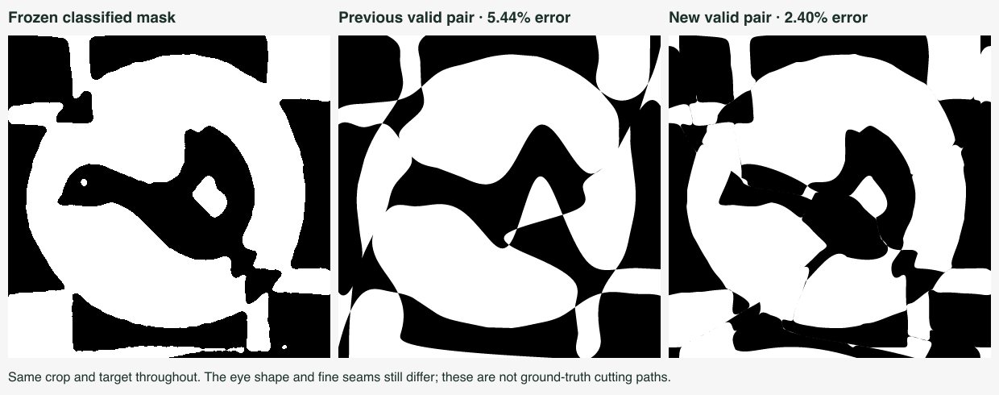

# Preserving small details through template fitting



This experiment keeps the photograph, automatic crop and classified mask fixed.
It tests template initialization, clearance, free-curve refinement, paper checks
and editable export. The frozen input is
[`photographic-bird-fit.json`](../../scripts/inverse/fixtures/photographic-bird-fit.json).
The corners and mask are diagnostic references, not known original artwork.
The initial sweeps and isolated unweighted refinements used the engine at
`42152c0`; later runs record their own source hashes rather than assuming that
the current fitter is the unchanged baseline.

## What failed

The previous valid bird pair disagreed with 5.44% of the source mask and lost the
eye. About two thirds of its mismatching pixels were outside the outer 5% band.
Holding the crop fixed isolates a real fitting problem; it does not establish
that the crop itself is exact.

1. **Count and routing proposals.** The ordinary best start used four cuts per
   sheet. The missing-feature fallback tried additional cuts in one sheet at a
   time. An exhaustive diagnostic sweep of 1–8 cuts in each sheet found a useful
   feature-weighted 5+5 start in the opposite phase. That joint count change was
   absent from the fallback. Its initial 9.11% error also narrowly exceeded the
   fallback's 9% admission threshold.
2. **Details lost between stages.** The useful starting grid contained the eye,
   but its cuts were too close. Unweighted clearance fitting removed the eye.
   Directly refining the unchecked seed did not solve this: the resulting pair
   had a self-intersection and still lost the eye. Extra initialization alone
   was insufficient.
3. **Paper-check resolution.** Some improved geometries were uncertain on the
   360-cell paper lattice. Rechecking unchanged coordinates at 700 cells resolved
   some, but not all, of those uncertainties. The closest unweighted result
   (1.92% error) remained uncertain and lost the eye; it was rejected.

## Bounded production change

After the existing missing-feature starts fail, try one extra cut in **both**
sheets, in both phases. This adds two hypotheses, not the exhaustive diagnostic
search. Only this extra routing gets the wider initialization allowance; the
final image, feature, geometry and paper thresholds remain unchanged.

Keep region importance through clearance and free-curve fitting for that new
routing. Protect all tracked regions, including details the original candidate
already retained. Skip the intervening unweighted grid polish, which can erase
the feature before curve fitting. Use the finer paper lattice for these
checkpoints and carry its resolution through Stop, cleanup and export, where the
actual coordinates are checked again.

The search's weighted errors never become final mask scores. Candidates compete
using the original unweighted source pixels; progress checkpoints report that
same original-image error. Ordinary candidates remain available as fallbacks.
Successful ordinary designs do not run this additional search.

## A second failure exposed by the broader sweep

The first ten-second sweep after the bird change returned 15/31 accepted
photographic cases, versus the preceding 16/31. The gift was the regression.
Its missing-feature fallback did **not** run: the same deterministic 5+5 grid
received more refinement steps before the deadline, and eventually developed
illegal geometry. The old selector then returned its lower image error instead
of retaining an earlier geometry-valid checkpoint with uncertain paper support.

A fixed 750-step replay reproduced this independently of the deadline. At the
256-cell fitting scale, the returned 1.98% checkpoint was illegal, while the
earlier 2.41% checkpoint passed a fresh 700-cell paper audit. Refinement now
retains the best geometry-valid uncertain checkpoint separately. It does not treat that checkpoint as accepted,
use it for safe rollback, or bypass the later paper check. Fully verified
checkpoints still take priority.

[`refinement-checkpoints.test.mjs`](../../scripts/inverse/refinement-checkpoints.test.mjs)
replays the image-derived initial grid, exercises the illegal later trajectory,
and independently validates and renders the retained pair. The first complete
gift replay with this fix returned about 2.3% mask error. This addresses a
latent checkpoint-selection problem rather than hiding the failed sweep.

## Visual limitation

The new bird pair is substantially closer and passes the existing checks, but
the eye is still imperfectly shaped and thin seams remain. Region retention is
not a proof of correct topology or faithful reconstruction of every detail.
Do not interpret a passing score as recovery of the unknown original templates.
No physical assembly has been tested.

A diagnostic also emphasized pixels surrounding each region, using 1, 2.5
and 5 mm radii. The first two variants retained the eye and passed geometric
checks, but visual review still showed a wedge and false seams; the widest
neighbourhood increased mask error to 4.33%. This extra weighting was not
integrated. The stage-study script accepts `--boost=16 --halo=0,4,10,20` to
reproduce those comparisons at the fixed 400-cell source resolution.

## Verification

- The complete ten-second hard-photo sweep returns **16/31**, preserving every
  previous passing case. The denominator includes three missing crop proposals.
  Fifteen incomplete photographs and one obscured photograph remain recorded
  separately. No crop coordinates, mask or fitting-probability hash changed in the paired
  comparison. All 28 produced outputs also pass editable SVG conversion and
  physical checks; the same 16 pass image fidelity after export.
- The eight difficult cases given a 25-second search budget improve from
  **5/8 to 6/8**. All eight outputs pass editable SVG conversion, geometry and
  paper checks; the star and crossed ribbons retain their source-feature
  warnings. Search budgets exclude some preparation and final reporting work,
  so total case time can exceed the requested search allowance.

  | Case | Search allowance | Previous independent mask error | Final error |
  | --- | ---: | ---: | ---: |
  | Gift | 10 s | 2.33% | 2.22% |
  | Bird | 25 s | 5.44% | 2.40% |
  | Viking | 25 s | 2.53% | 2.27% |

- All 22 regular Hunodan designs pass, with **exactly unchanged independent
  image errors** relative to the preceding run. The slowest prepare, solve,
  validation and export took **8.51 seconds**. None ran the additional feature
  search. Image decoding and the independent external renderer are outside that
  timing, as in the existing benchmark.
- The frozen bird mask passes the real browser worker, feature checks, editable
  conversion, SVG download/reparse, physical checks on downloaded coordinates,
  and PDF download in Chromium and WebKit. Editable errors were **2.62% and
  2.46%**, with **23.94 and 24.97 seconds** from Find to an editable result.
- Interrupting a real finer-resolution checkpoint returned a verified editable
  pair in **5.31 seconds** in Chromium and **5.02 seconds** in WebKit. Both stopped
  exports remained below 3% original-mask error and retained the tracked details.
  The QA-only worker pause supplies no geometry or seed to the fitter.
- The existing uploaded-puppy browser regression also passes in both engines.
- `npm test`: 854 application tests passed, one existing skip; all 567 inverse
  tests passed. `npm run check`: zero errors and seven existing warnings.
  `npm run lint` and `npm run build` pass.

The browser test imports the frozen photographic mask as pixels to isolate
template detection from crop variation. The separate photo benchmark reruns
automatic cropping from the original photograph. These are distinct checks.

Full input/source hashes, paired results, rejected experiments, intermediate
failures and validation records are in
[`BIRD-FEATURE-VALIDATION.json`](BIRD-FEATURE-VALIDATION.json).

## Reproduction

Run these diagnostic jobs sequentially:

```sh
node scripts/inverse/bird-initialization-study.mjs
node scripts/inverse/bird-refinement-study.mjs
node scripts/inverse/bird-stage-study.mjs
node scripts/inverse/hard-photo-benchmark.mjs --ids=bird --target=mask --seconds=25 --output=tmp/bird-replay
node scripts/inverse/hard-photo-editor-replay.mjs --run=tmp/bird-replay --output=tmp/bird-editable-replay
```

The exhaustive initialization sweep is experimental only. Its initialization
time is recorded separately from the isolated refinement timings. The stage
study has fixed iteration counts without a production deadline. Production
benchmarks include their own fresh initialization and independently render the
exported cuts.
