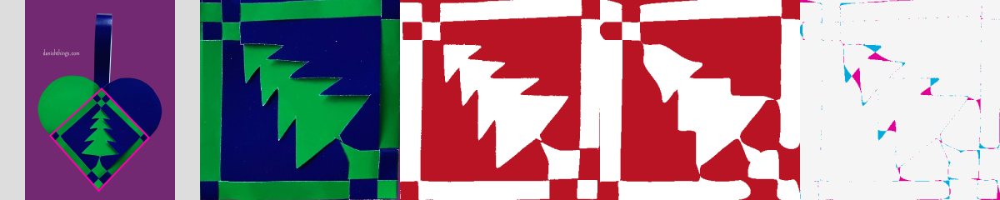
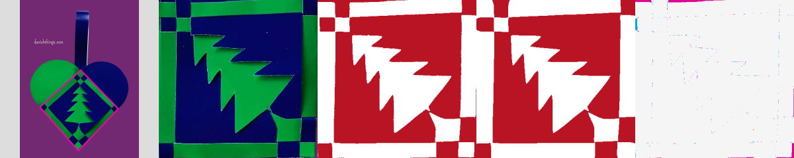

# Coarse routing followed by the common curve fitter

The green/blue Danish Things tree exposed a template-initialization failure on
an unchanged automatic crop. Its initial grids miss the sharp branches. The
fine boundary has 125 segments and 0.61% mask disagreement, so the usual 0.5%
seed gate rejects it. Raising that gate alone is insufficient: the repaired
boundary gives 146 visible graph edges and 580 hidden candidates. Successive
MILP routings contain narrow returns and do not pass the geometry checks within
a ten-second probe budget.

Coarser boundary fitting, a small amount of smoothing, and the existing junction
repair reduce that input to about 48 segments. This produces a valid three-cut
routing that the **same Bézier/straight-span optimizer** can refine against the
original classified photograph. No template geometry enters fitting, no crop
coordinates move during optimization, and no physical checks are relaxed.

## Selection and safeguards

This is an additional candidate for a poor initialization, not a new user mode.
The fitter tries it only when the best coarse grid exceeds twice the allowed
image error, every fine-grid candidate still exceeds that limit, and sufficient
time remains. Weighted/free-border inputs and unsupported symmetry constraints
retain their existing routes.

The small portfolio combines two fitting tolerances with three border depths,
with a 2.5-second budget for preparation and routing. Seeds must retain the
original image features, have consistent and sufficiently spaced endpoints,
contain at most 64 segments, and differ from the original mask by at most 2.5%
(or the user's stricter image limit). A seed also has to pass the normal geometry
and paper checks before entering refinement. The refined seed competes with the
normal grid candidates; it cannot replace the source mask or its error reference.

The successful fast initialization paths remain intact. A first Hunodan replay
showed an unnecessary extra routing attempt after a usable fine grid had already
been found. Checking all fine-grid errors before launching this portfolio avoids
that detour.

## What improved, and what did not

On the frozen automatic green-tree crop:

| Measurement | Earlier grid fit | New routing plus refinement |
| --- | ---: | ---: |
| Final independently rendered mask disagreement | 2.65% | 1.14% |
| Disagreement in the central 60% square | 4.12% | 0.35% |
| Identical cutting templates | No | No |
| Slits per sheet | 3 | 3 |
| Geometry, paper and feature checks | Pass | Pass |

The first integrated candidate scored 1.88% before the matching-sheet preference.
That initially selected identical templates at 2.89%. A separate run with matching
disabled exposed an ordering error: removing one redundant curve return unlocked
refinement to about 1.10%, but this repair ran **after** the matching decision.
The preference was therefore using a worse independent baseline than necessary.

Redundant returns are now repaired before comparing sheets. If matching replaces
the pair, its geometry still receives the later repair and shared-seam checks.
For this crop, identical sheets must disagree with at least 2.635% of the mask,
whereas the repaired independent baseline is 1.10%. The one-point allowance
therefore cannot justify identical sheets, and the fitter correctly retains the
independent pair. Final cleanup and independent resvg rendering give the 1.14%
measurement above. The symmetry bound describes the classified photograph,
not the symmetry of unavailable original artwork or ideal cutting paths.

The central region measurement isolates the branch detail that the surrounding
frame can hide in a whole-image average. Neither metric measures agreement with
digitized original cutting paths.

Columns: source and fixed automatic crop, rectified photograph, classified mask,
independently rendered final templates, difference.




The red/white tree's automatic crop still fails. A previous manual-crop diagnostic
passes, so this routing change does not remove the separate need to improve that
crop. See [the full-pipeline diagnosis](FULL-PIPELINE.md).

## Validation

All 22 regular Hunodan cases pass the frozen quality and speed criteria, with
exactly unchanged independently rendered errors. Median prepare/solve/export
time is 5.09 seconds and the maximum is 8.29 seconds. The broader eight-photo
replay retains six passes, the red-tree review warning, and the missing angel
crop. No other photo's measured error increased.

All 842 application tests and 520 inverse-engine tests pass, with one existing
application-test skip. Type checking has zero errors and seven existing warnings;
lint and the production build pass. Sixteen production-browser workflows pass
in Chromium and WebKit, including the original green-tree photograph through
automatic cropping, the actual worker, editable SVG, PDF and editor validation.
Its click-to-editable time is 7.78 seconds in Chromium and 9.01 seconds in WebKit.
The browser flow selects between-lobes symmetry Off, disabling the matching-sheet
preference; the command-line comparison keeps that preference enabled. These
settings and the two export renderers are recorded separately. Both browser outputs
preserve the branches and pass the editor's curve checks; the converted geometry has no sampled weave drift at 400 or 800 pixels.

[The validation ledger](COARSE-TOPOLOGY-VALIDATION.json) records source hashes,
settings, crop coordinates, rejected probes, timings and local artifacts. Firefox
was not repeated after its previously recorded native launch failure.

## Reproduction

```sh
node --test scripts/inverse/coarse-topology.test.mjs
node scripts/inverse/web-photo-benchmark.mjs --stage=solve --seconds=10 --ids=danish-tree-green,danish-tree-red
INVERSE_TEST_CASES=web-danish-tree-green INVERSE_TEST_BROWSERS=chromium,webkit node scripts/inverse/paint-browser-test.mjs
```

The test freezes previously detected crop coordinates and independently renders
the exported curves. It checks branch-region fidelity, the repaired matching baseline,
cut counts, template validity, and source immutability. Browser replays use the
original photograph, automatic crop detection, the actual compute worker, and
editable SVG/PDF downloads. Configure `INVERSE_TEST_URL` and `PLAYWRIGHT_MODULE`
for the local preview and existing Playwright installation.
