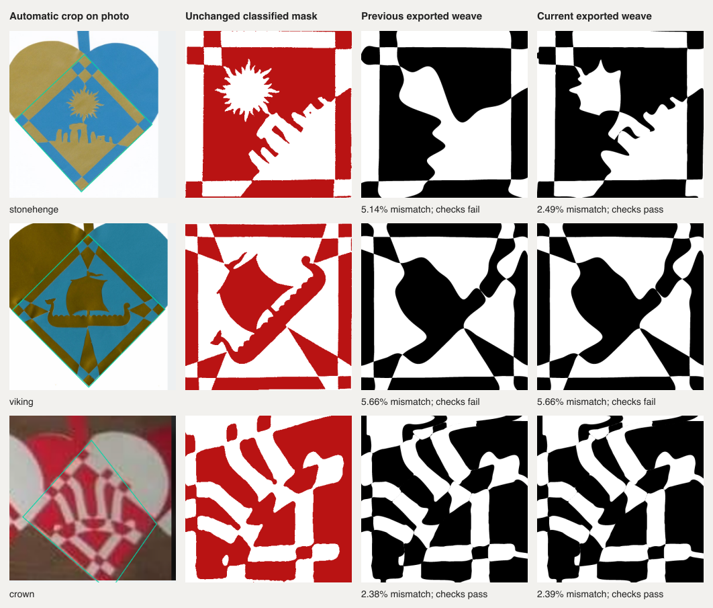

# Reserving fitting time for photographic detail

This continues the full-pipeline investigation in
[SHARING-SOURCE-VALIDATION.json](SHARING-SOURCE-VALIDATION.json). The production
changes are `7db1655`, `b8f2191` and `2bf8171`. Cropping, colour classification, source masks
and final acceptance thresholds are unchanged.

## Failures downstream of cropping

With a ten-second search allowance, the automatically cropped Stonehenge and
Viking photographs returned effectively unrefined grids. Speculative traced
routing consumed the time needed to move the cutting curves. This was not an
opposite-border rejection by itself: the direct fitter already had independent
grid candidates available, but did not get to refine useful ones.

Two initialization problems compounded the scheduling problem:

- The complexity preference put a 4 + 4 Viking grid ahead of existing 6 + 6
  finalists that retained its white opening. The simpler grid erased it.
- Stonehenge's ordinary grids erased an isolated red stone. The existing
  image-derived, feature-weighted initializer could recover it with 3 + 3 cuts,
  but previously ran too late in a short search.

Poor-grid finalists now prefer retaining source colours before the complexity
bonus. This reorders existing candidates and adds no slit-count hypotheses.
Short searches can try the existing feature initializer early when a poor grid
erases a source region. Traced routing leaves time for actual curve refinement;
when feature protection actually selects a different grid which preserves the
protected regions, it receives a short routing probe before refinement. A poor
grid which merely retains a large colour region can still miss its branches;
it keeps the normal routing allowance.

A useful negative control is the crown. Its coarse grid retained the white
opening's pixels but had not yet enclosed them. Treating that as an erased
region displaced a layout which normal refinement could repair. The corrected
condition preserves that layout. Enclosure remains mandatory in the final
feature audit; the change concerns which initializer gets time first.

The early-seed and routing-budget changes apply to requests of at most ten
seconds. Candidate ordering also applies to longer searches. The webapp's
longer default search allowance is tested separately; ten-second engine results
are not claims about default click-to-ready latency.

## Rejected changes

Skipping routing entirely regressed regular Hunodan `hjfig-05`, whose traced
routing is fast and useful. A 0.75-second probe restored it. Reserving a further
6 + 6 Stonehenge grid also failed: although its coarse mask kept the stone,
physical refinement stalled and displaced a better candidate. That experiment
is not in production. A generic short routing probe also regressed two tree
photographs and an uploaded crop. Their existing regression tests exposed the
loss of useful smoothing and boundary-profile retries. Restricting the shortcut
to an actually changed feature-preserving initializer restores all three.
Broad early feature initialization regressed the crown
from 2.38% to 4.99% disagreement; the retained-colour distinction above fixes it.

## What numerical success does not establish

Independent source-mask agreement, substantial region retention, legal geometry
and nominal paper checks are separate from visual reconstruction quality. The
short Stonehenge fit still rounds away several sun rays. Even successful Viking
fits show thin seams; the latest full short-budget run returned a poor grid. Keeping an opening or stone is a measurable improvement, but
these are not exact reconstructions of the original cutting templates.

The earlier crop and classification failures also remain: jigsaw has a distorted
automatic overlap; bauble loses its frame during classification even in a fixed
historical crop. Improving a fit to those damaged masks cannot recover the
photographed design. Source photo, crop, mask, engine-exported weave and editable
SVG are therefore retained as separate evidence.

## Final engine and export replay

The [validation ledger](FEATURE-BUDGET-VALIDATION.json) records the complete
results, input and implementation hashes, rejected experiments and timings.

The latest ten-second hard-photo replay is **22/31**, up from 21/31, with every
previous success retained. All crop, classified-mask and fitting-probability
hashes match the preceding run. Stonehenge improves from 5.144% to 2.492%
independent disagreement and preserves the isolated stone. The crown remains
accepted at 2.39%.

**Viking is not a reliable ten-second success yet.** An earlier complete run
reached 23/31, and focused fresh-fit tests also preserve its opening below 3%
error. The latest full replay instead returned the old 5.657% poor fit.
Initialization took 2.33 seconds instead of 0.59, and fine-grid fitting took
1.76 instead of 0.70, leaving only 1.41 seconds for the promising 6 + 6 candidate's
first curve refinement. These measurements identify budget sensitivity; they
do not establish why those stages ran more slowly. The unsuccessful run remains
in the final denominator and figure.



All **28 produced pairs** pass editable SVG conversion, the editor's intersection
rules and the geometric/paper recheck. **22** also pass the source-image and
feature criteria after editable export. Three cases still have no crop. The
remaining complete cases and the 16 partial/obscured motifs are preserved in the
ledger.

All **22 regular Hunodan designs** pass the existing speed and quality gates;
the slowest takes **9.45 seconds**. The deadline-limited `hjstr-03` has six extra
mismatched pixels against the previous run: **0.5613% → 0.5653%** disagreement at
388 × 388. Its final polishing checkpoint varies, and it exercises neither the
new routing shortcut nor the finalist preference. Other cases have no error
increase. This is not a claim of byte-identical results under wall-clock budgets.

All **855 application tests** (one existing skip) and **588 inverse tests** pass.
Type checking has no errors and seven existing warnings; lint and build pass.
The new photographic test checks actual exported quality at two resolutions,
rather than requiring a fixed refinement-iteration count within a time limit.
After separating Viking's longer functional allowance from its unchanged
ten-second benchmark, all three focused replays pass again.

## Actual browser workflow

All **22 workflows** pass in Chromium and WebKit against the rebuilt preview.
These include original Stonehenge, Viking and puppy photograph uploads, a
half-resolution puppy, the shifted puppy mask, bird and gift masks, both tree
regressions, the independent free-border hat and the star. The harness performs
real UI import and fitting, opens Draw, downloads SVG, checks the editor rules,
re-renders the source comparison and rechecks paper support. The star and mask
cases also exercise PDF download.

The app uses its **180-second maximum**, rather than the ten-second benchmark
allowance. Stonehenge takes **16.95 / 17.14 seconds** from Find to ready in
Chromium / WebKit. Viking takes **32.85 / 36.62 seconds**. Both retain their
protected regions and pass the editable checks, but the inspected Stonehenge
still has too few sun rays. Browser timings do not establish a ten-second Viking
solution or exact recovery of the photographic outline.

Both **Stop during detail refinement** tests also pass, returning a validated,
editable retained template. Their private test server stalls the actual worker
after a real validated checkpoint; it does not inject saved curves. All **65
served core and worker JavaScript assets** match the tested workspace. The
preview was restarted after the build and left running at
`http://127.0.0.1:5232/en/editor/paint/`. Nothing was pushed or deployed.

## Reproduction

The focused test starts from committed photograph pixels and frozen production
automatic crops. Stonehenge and crown use ten-second allowances. Viking uses a
60-second functional allowance because its ten-second performance remains
unreliable; the unchanged full-corpus benchmark records that failure separately. It hashes the original masks and fitting probabilities, starts
fresh fits without saved cuts, and re-renders the exported curves at 400 and 800
cells. It checks the Stonehenge stone, Viking opening and crown against the
unchanged feature and geometry rules.

```sh
node --test --test-concurrency=1 scripts/inverse/short-budget-features.test.mjs
INVERSE_SPEED_OUT=tmp/feature-budget-hunodan-new node scripts/inverse/hunodan-speed-benchmark.mjs
node scripts/inverse/hard-photo-benchmark.mjs --crop=automatic --target=mask --seconds=10 --output=tmp/feature-budget-hard-new
node scripts/inverse/hard-photo-editor-replay.mjs --run=tmp/feature-budget-hard-new --output=tmp/feature-budget-editor-new
```

The photographic benchmark keeps all 31 complete cases in its denominator,
including failures to propose a crop; 16 partial or obscured motifs remain in
the inventory. Its timer excludes crop detection and decoding and includes
independent replay and artifact writes. The separate regular benchmark's
10-second gate includes preparation, solve, validation and export, but excludes
decoding and independent replay. Actual browser tests measure click-to-ready
with the page clock and audit the downloaded editable geometry.

## Follow-up: defer speculative routing and finish accepted-route polishing

Commits `1991e27` and `4c6f1a7` extend the scheduling fix to longer requests and
remove a premature polishing cutoff. The complete follow-up measurements are
in [DEFERRED-ROUTING-VALIDATION.json](DEFERRED-ROUTING-VALIDATION.json).

When feature protection selects a different grid that retains the source
regions, a longer search now tries a short routing probe before refining that
grid. If no candidate passes the original image, feature, geometry and paper
checks after its first refinement, the unused routing allowance remains
available. A regression expires the first probe by advancing the test clock;
the real photograph then needs the resumed routing to recover a valid 4 + 4
pair below 0.95% independently rendered disagreement. Ordinary finalists and
the useful tree smoothing/border retries remain available.

The regular benchmark exposed a separate source of timing sensitivity. A
recovered `hjfig-05` route stopped polishing after 125 of 160 steps at the
existing 0.7-second cap, despite finishing the overall request in about four
seconds. Its exported error rose from 0.9043% to 0.9351%. An already accepted
route now gets the remaining existing deadline to finish its 160-step polish;
provisional routes retain their small allowance. A controlled 450 ms checkpoint
delay reproduces 1.0152% error before this fix and passes the below-0.91% export
regression afterward, within the ten-second request. No source pixels or
acceptance thresholds change.

The final fresh Viking replay falls from **30.68 to 24.54 seconds**, with
**byte-identical exported cutting geometry and rendered preview** and 2.2656%
source-mask disagreement. Actual browser click-to-ready times improve from
32.85 to 26.65 seconds in Chromium and 36.62 to 32.26 in WebKit. Chromium's
engine error is unchanged; WebKit's is slightly lower. Browser source-resolution
editable errors are recorded separately from the older, differently sampled
200-cell diagnostic.

All **22 regular Hunodan designs** pass again, with a maximum of **9.29 seconds**.
Against the preceding verified run, 21 have identical independently rendered
error and `hjstr-03` improves from 0.5653% to 0.5580%; none is worse. The final
ten-second hard-photo run reaches **23/31**, retaining every previous success.
All 28 produced pairs pass editable conversion, editor intersections and paper
checks; 23 also pass the image/feature gates. The three crop failures and 16
partial/obscured motifs remain visible in the ledger. All crop, mask and fitting
probability hashes for the 28 prepared inputs are unchanged.

All **855 application tests** (one existing skip), **589 inverse tests**, type
checking, lint and build pass. Type checking retains the same seven warnings.
All **24 real browser workflows** pass in Chromium and WebKit, including the
star, independently fitted free-border hat, difficult photographs and masks,
both tree regressions, and `hjfig-05`. Both Stop-during-detail checks retain an
editable valid candidate, in 3.78/4.05 seconds after Stop. All **65 served engine
and worker files** match the tested source. The rebuilt preview remains at
<http://127.0.0.1:5232/en/editor/paint/>. Nothing was pushed or deployed.

The limitations above remain. Viking still has visible thin seams and distorted
border details, and Stonehenge loses sun rays. Viking's short-budget result has
varied across earlier runs; the latest 23/31 is not a claim of guaranteed
ten-second photographic reconstruction or exact recovery of the original cuts.

The remaining failures also help scope a future learned graph proposal. Three
cases have no crop (`nested-squares`, `santa`, `bibel-star-outline`), and three
stop traced recovery at inconsistent endpoint counts (`jigsaw`,
`crossed-ribbons`, `bauble`). `outline-star` reaches routing time limits; `bird`
exhausts some candidate graphs and times out on smoother alternatives. These
are observed stages, not complete causal diagnoses. Ranking existing hidden
connectors alone cannot affect the six failures before graph search. Oracle
experiments should therefore separate crop/mask/endpoint corrections, candidate
coverage, graph pruning and curve initialization. No neural model was trained.
