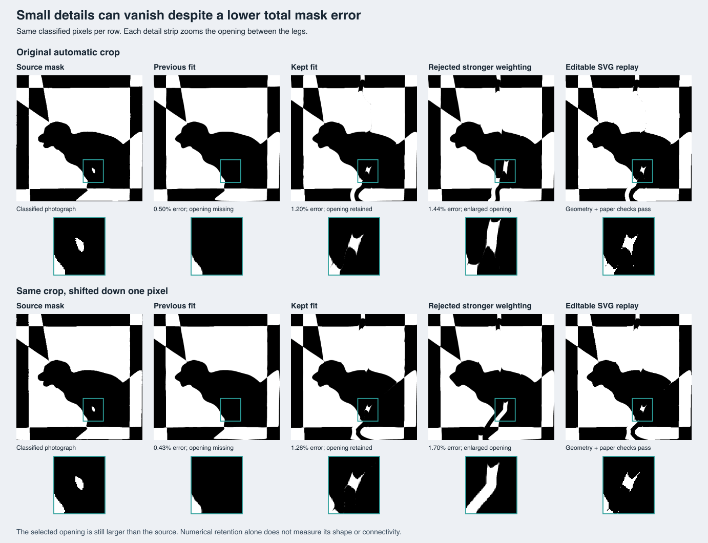

# Preserving small details during template fitting

The puppy photograph exposed two failures after cropping and classification.
Its small white opening between the legs survived both operations, but the
ten-second template fit omitted it. Total mask disagreement was only about
0.5%, so ranking by that number alone hid an important loss of motif structure.
The source-feature check correctly kept this result out of the accepted set.

This change addresses scheduling and checkpoint selection in the main direct
Bézier fitter. It does not change crop coordinates, classified pixels, the 3%
image-error limit or the geometry and paper acceptance rules.

## Root causes and changes

**Initialization arrived too late.** A close ordinary grid omitted the small
opening, and local curve gradients could not discover a remote missing region.
The fitter first spent much of its remaining budget on unsuccessful traced
recovery. An existing image-derived feature initializer could find a useful
five-by-three layout, but usually only got a turn with a longer search budget.

When an otherwise close grid misses a source feature, the fitter now tries one
feature-preserving layout before traced recovery. This is the existing adjacent
count search, using only the classified image. The ordinary finalists remain as
fallbacks. Requested symmetries and the free-border objective keep their existing
routes. A border-only missing feature does not trigger a forced interior layout.

**Fine-grid polishing could erase the initializer's gain.** Moving the frozen
crop down by one original-image pixel still produces a feature-retaining starting
grid. Ordinary fine-grid polishing then prefers a lower whole-image error that
fills the opening. That is a fitting failure, even though a crop perturbation
exposes it.

Feature-derived seeds now retain a feature-preserving checkpoint while following
the ordinary image gradient. Both the grid stage and free-curve refinement accept
an optional checkpoint preference. Within each physical validity class, preferred
checkpoints compete on the existing objective. If no preferred point exists, the
ordinary best fallback remains available. A paper-uncertain point still needs an
independent finer audit; preference never certifies geometry or changes rollback
safety. Straightening proposals also compete with their unsimplified counterparts
when straightening would erase the feature.

The source mask is immutable. The regression starts from the shifted photograph,
checks its classified-pixel hash, demonstrates the lost opening without checkpoint
preference, then fits and independently renders fresh curves with the fix. It also
checks that the recovered opening remains a separate component with reasonable
overlap. No saved template is supplied to the fit.

## Dataset and export results

The complete automatic-crop, import-to-mask benchmark improves from **20/31 to
21/31** accepted photographs with a ten-second fitting allowance. The new success
is the puppy. Every previous success remains accepted, and all crop coordinates,
classified-mask hashes and fitting-input hashes are unchanged. The 16 incomplete
or obscured inventory entries remain excluded; three complete photographs with no
crop remain failures in the denominator.

The puppy's disagreement increases from 0.4963% to **1.2013%**, because the old fit
erased its small opening and failed the source-feature check. A lower whole-image
error alone would select that incomplete reconstruction. The new pair passes the
same source-feature, geometry and nominal paper checks.



All **22 regular Hunodan photographs** pass with exactly unchanged image errors.
The slowest preparation + solve + validation + export takes **8.376 seconds**;
decoding and the independent external renderer are excluded. Five ordinary hard
photo fits change slightly in the time-bounded rerun, without invoking the new
early layout. Four improve; the dense checker changes from 0.69625% to 0.70000%
error, a six-pixel difference. The hard-photo errors are not described as uniformly
unchanged or lower.

The targeted 25-second rerun passes all four cases: bird, crown, puppy and
Stonehenge. The first three retain their previous independent-render errors;
Stonehenge changes from 2.6394% to 2.4919%. This is a four-case check, not a rerun
of the entire earlier longer-budget dataset.

The frozen-crop perturbation test improves from **1/4 to 2/4** accepted results:

| Perturbation | Result | Remaining limitation |
| --- | --- | --- |
| Crop moved right one original-image pixel | Fails source-feature check | Opening lost during later fitting |
| Crop moved down one original-image pixel | Pass, 1.26% disagreement | Separate opening still larger than the source |
| JPEG quality 75 | Pass, 1.57% disagreement | Existing success retained |
| Half-resolution photograph | Fails source-feature check | Ordinary feature initializer finds no acceptable seed |

All **28 produced ten-second pairs**, **four perturbation pairs** and **four
longer-budget pairs** pass editable conversion, SVG serialization/parsing, the
editor's intersection rules and the geometry/paper re-audit. Complete acceptance
remains 21, two and four respectively. Export validity does not promote an
inaccurate or feature-losing reconstruction into a success.

The remaining ten-second failures span the pipeline: three missing crops, two
unrepresented small source regions near the crop boundary, and five fits above
the image-error limit. The boundary regions may be motif details or photographic
artifacts; this change neither classifies them as noise nor relaxes their check.

## Experiments rejected after visual inspection

More numerical passes did not always mean better reconstructions. Stronger
feature weights and a two-layout trial could retain enough white source pixels
to clear the feature gate while enlarging the opening or joining it to the white
background. One two-layout result expanded a roughly 7 mm² opening to 82 mm²;
another expanded it to 54 mm². Those variants are not shipped.

The diagnostic reports distinguish retained source pixels from overlap with the
entire matching output component. The latter penalizes an oversized opening or
an unintended connection to the background. This is a raster diagnostic, not a
new production acceptance rule or a physical certificate. The selected result
still does not reproduce the opening exactly.

`feature-checkpoint-study.mjs` follows fixed source pixels and a fresh image-derived
seed through initialization, fine-grid fitting, clearance and free-curve
checkpoints. It compares ordinary fitting with several weighting strategies at
fixed iteration counts and paper resolution 700. Those experiments have no
production deadline and change the clearance margin relative to the usual coarse
audit; they are not production speed results. Its stronger initialization fallback
is diagnostic only.

The unresolved perturbations need better starting geometry, not just stronger
weights. The one-pixel horizontal shift loses its opening during later fitting;
the half-resolution image has no acceptable feature-preserving seed under the
ordinary initialization settings. Both source masks still contain the opening.
Small border changes can also turn a large background region into an interior
component, changing a component-weighted objective substantially. These are
distinct failure modes that a single whole-image error percentage misses.

## Reproduction

```sh
node --test --test-concurrency=1 scripts/inverse/feature-seeds.test.mjs scripts/inverse/refinement-checkpoints.test.mjs
node scripts/inverse/hard-photo-benchmark.mjs --seconds=10 --target=mask --output=tmp/feature-replay
node scripts/inverse/hard-photo-editor-replay.mjs --run=tmp/feature-replay --output=tmp/feature-editable
node scripts/inverse/feature-checkpoint-study.mjs --run=tmp/feature-replay --ids=flettede-puppy --output=tmp/feature-study
```

The hard-photo benchmark reports crop detection separately. Its `runs[].seconds`
starts after detection and source-thumbnail creation; it includes preparation,
solving, validation, exports, independent replay and artifact writes. The
ten-second solver allowance is not a click-to-ready promise. Browser timings use
the page clock from the Find click until the editable result is ready.

For the ten-second puppy run, solve and validation take **9.387 seconds**. The
recorded post-detection total is **9.854 seconds**, and crop detection adds another
**0.901 seconds**. Neither figure includes photograph decoding or source-thumbnail
creation. These limits matter when comparing solver speed with the upload flow.

## Browser and release verification

All eight normal browser cases pass in Chromium and WebKit: the original puppy
photograph through automatic crop detection, the frozen bird mask, the free-border
hat with independent sheets, and the star example. Checks include real workers,
editable conversion, source-feature retention, legal cuts, paper support and
SVG/PDF downloads. The hat also checks that shared cuts survive conversion.

| Case | Chromium Find-to-ready | WebKit Find-to-ready |
| --- | ---: | ---: |
| Puppy photograph | 18.68 s | 23.97 s |
| Bird mask | 24.47 s | 26.83 s |
| Free-border hat | 6.11 s | 6.26 s |
| Star example | 1.91 s | 2.10 s |

These use the application's normal 180-second maximum, not the ten-second
benchmark setting. Crop selection happens before the Find click. The puppy's
editable output has 1.19% disagreement in both browsers and retains a separate
opening. Its full component overlap with the source opening is only 0.54–0.55,
so this is improved feature retention, not exact shape recovery. The bird eye
remains separate with component overlap of 0.86–0.91.

Both additional Stop checks pass. A QA-only HTTP proxy pauses the compute worker
immediately after its first qualifying finer-verified candidate; the user-facing
Stop action retains that candidate, revalidates it and exports editable geometry.
Stop-to-ready takes 3.49–3.92 seconds. The final opening remains separate, and the
actual retained paper resolution is used by export and the independent re-audit.
The proxy intervention is never included in the production build.

`npm test` passes **854 application tests** (one existing skip) and **572 inverse
tests**. `npm run check` has no errors and seven existing warnings; lint and the
production build pass. An older budget test expected the original puppy to reach
unsuccessful traced recovery. That fixture now succeeds earlier, so the regression
uses the unresolved half-resolution perturbation to keep testing recovery-budget
reservation. The corrected full suite was rerun successfully.

The [machine-readable validation ledger](FEATURE-CHECKPOINT-VALIDATION.json)
records per-case outcomes, unchanged inputs, source hashes, independent component
measurements, rejected prototypes and artifact checksums. Scores measure agreement
with classified photographs, not original cutting paths. Paper checks remain
nominal geometric tests; these fitted hearts have not been physically assembled.
