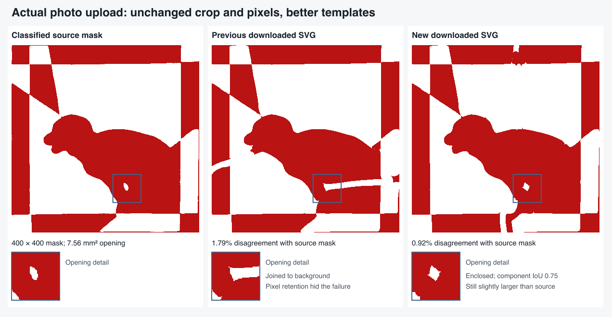

# Preserving enclosed features through fitting and export

This follows the actual browser-upload failure in
[FEATURE-RESOLUTION.md](FEATURE-RESOLUTION.md). The smaller puppy photograph
retained over 90% of its white opening's pixels, but that opening joined the
background. Mean mask error and pixel retention therefore reported success for
the wrong shape. The crop and classified pixels already contained the opening.

## Changes

Final feature fidelity now checks whether a small, substantial interior region
remains separate from the square boundary. It keeps the existing colour-retention
checks and their thresholds. Regions at the crop margin or ending at an
unobserved/free boundary do not acquire an enclosure requirement. This is a
raster check, not an exact topological or paper-strength certificate.

The same fidelity check is used for accepted direct and traced candidates,
matching-sheet proposals, final reports, graceful Stop and independent replay.
Final shared-cut, primitive and short-return cleanup may improve an already
imperfect pair, but cannot open a region that its incoming checkpoint enclosed.
A failed fidelity check produces a warning; the template remains downloadable.

The feature initializer already computes several starting layouts. If refinement
opens a protected region, the fitter can reuse **one** of those remaining starts
within the original time allowance. It does not rerun or broaden slit-count
initialization. Ordinary candidates remain available. Once a valid routing
encloses the region, its existing local feature-detail refinement can improve
the shape. Weighted detail losses never replace the original image, geometry
or paper checks used to accept a result.

## Why checking every intermediate grid was wrong

Two regressions clarified where enclosure belongs. Requiring a closed region
during clearance-grid selection changed the original puppy's starting geometry;
the subsequent curve fit could not establish valid paper support. Clearance
grids remain proposals, with colour retention protected before free-curve fitting
and full fidelity checked for accepted candidates.

The bird's joint feature routing also needs its local detail pass to close the
eye. Rejecting it and searching ordinary grids first exhausted that refinement
opportunity. Its established detail pass now runs before that competition.
The original bird, puppy, fixed-crop perturbations and actual upload have focused
regressions covering these distinctions.

Component measurements now flood only output regions touched by the protected
source pixels. This preserves the complete component area and boundary status
while avoiding unrelated background scans at every checkpoint. All 94 stored
region measurements across 28 previously exported photographs match exactly.

## Input and validation evidence

`browser-puppy-half-mask.json` records the real automatic crop, transformed photo
hashes and exact 400-cell browser mask, with run-length encoded pixels. Its saved
bad geometry tests final validation only. Fresh fitting receives **only the
mask**, never those cuts. Chromium and WebKit previously produced the same mask
hash, and the browser regression checks that the crop and classified input remain
unchanged while testing the new fitter.

The focused fresh fit verifies enclosure, whole-component overlap above 0.65,
independent exported-weave disagreement below 1.5%, unchanged input arrays and
at most one alternate from the existing feature initialization. The captured old
pair remains geometrically valid and below 2% disagreement, but now fails final
feature fidelity because its opening connects to the background.

All 855 application tests (one existing skip) and 584 inverse tests pass. Type
checking reports no errors and seven existing warnings; lint and build pass.

## Fresh full-pipeline results

Production code: `d7c46c7`, including `ca1df9b` and `0e6a208`. The complete
[measurement ledger](FEATURE-ENCLOSURE-VALIDATION.json) records source hashes,
per-case outcomes and timings. Crops and all classified/fitting mask and
probability hashes match the preceding release across the three photo replays.
No ground-truth cuts are supplied to fitting.

| Replay | Result |
| --- | --- |
| 22 regular Hunodan designs | 22/22 pass; slowest 9.14 s; every cut-geometry file and measured error unchanged |
| Hard photos, 10 s search budget | 21/31 complete passes; all 28 generated pairs survive editable SVG conversion |
| Four fixed-crop perturbations | 3/4 complete passes; all four remain editable |
| Four difficult photos, 25 s budget | Bird, crown, puppy and Stonehenge all pass through editable export |
| Actual browser upload/paint → solve → Draw → SVG | 12/12 workflows pass in Chromium and WebKit |
| Stop with a retained, finer-verified candidate | 2/2 browser workflows pass; 3.60–3.93 s from Stop to ready |

The regular timing includes preparation, solve, validation and export, excluding
image decoding and independent replay. The photo search budgets are not promises
about click-to-ready latency. The browser checks use actual uploads or painted
masks, workers and WASM, followed by independent checks of the downloaded SVG.
All 65 served core/worker JavaScript files match the workspace used for these runs.

The smaller actual upload now preserves a separate opening in both browsers:
Chromium's downloaded SVG has **0.915%** disagreement and opening-component IoU
**0.745**; WebKit has **0.904%** and **0.759**, respectively. Its automatically
detected quad and 400-cell classified mask match the failing prior run exactly.
The prior Chromium SVG had **1.791%** disagreement, yet its opening was joined to
the background despite retaining 95% of the source opening's pixels. These
percentages are all recomputed at the same source resolution.

Visual inspection confirms the channel is gone. The recovered opening is still
larger and more angular than the source. The new fit also has visible defects in
the top and bottom frame, so passing the stated checks does not imply an exact
reconstruction. Actual click-to-ready latency for this upload was 22.16 s in
Chromium and 24.38 s in WebKit.

The frozen JPEG-75 perturbation also improves: editable disagreement falls from
1.631% to 1.403%, and opening IoU rises from 0.681 to 0.944. The separate
fixed-crop half-resolution case is a different input from the browser upload;
its opening remains oversized (IoU 0.554). The one-pixel vertical crop shift
also passes with an oversized opening (IoU 0.557).

## Remaining failures and scope

The one-pixel **horizontal** crop shift still loses the opening completely,
despite only 0.451% global disagreement. It remains a failure. The ten failures
in the 31-photo replay are three missing crops (nested squares, Santa and the
Bible Society outline star), two omitted-feature failures below 3% error
(outline star and crossed ribbons), and five above that error threshold (bird,
jigsaw, bauble, Stonehenge and Viking ship). More time recovers bird and
Stonehenge, as recorded separately above.

Thus this change fixes template fitting and acceptance for a real upload without
changing its crop or classification. It does not improve the aggregate 21/31
photo count, resolve all perturbations or establish agreement with unavailable
original cutting paths. Geometry and paper checks remain numerical; no physical
cutting, threading or assembly test has been performed.
