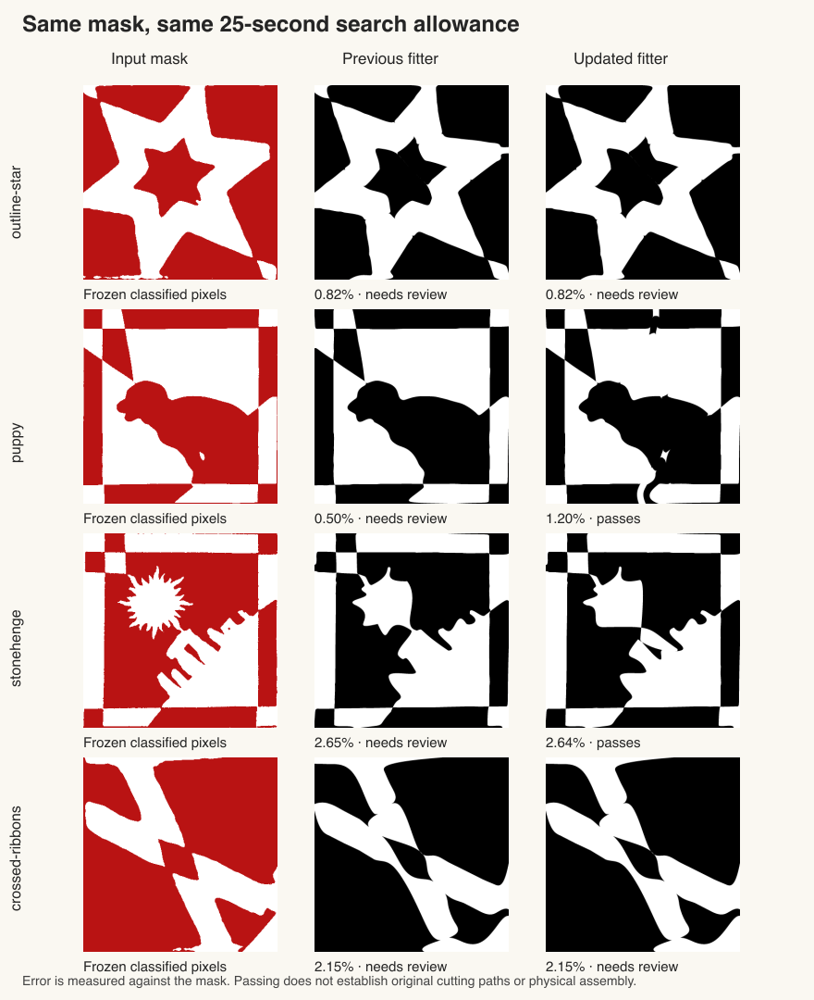

# Recovering motif features through the complete template pipeline

2026-10-12. Follow-up to [the initialization study](FEATURE-SEED-STUDY.md).
The additional starting layouts and finer paper verification are now in the
production fitter. This work changes template reconstruction and export; it
does not change crop proposals, classified masks or acceptance tolerances.



## Identical-input comparisons

The complete automatic-crop corpus contains 31 usable hearts. With the actual
imported-mask path and a ten-second solver allowance, accepted reconstructions
increase from **11/31 to 16/31**. Every previously accepted case keeps exactly
the same independent image error. Gift, gingerbread, round checkerboard, orb
and crown become accepted. The three missing crop proposals remain failures.

An additional paired experiment gives eight difficult cases a 25-second solver
allowance. The old engine is an isolated `aa3edeb` source snapshot, including its
preparation and fitting code. Mask and fitting-probability hashes match for
every pair. An intermediate version passed **6/8**, but visual inspection
rejected the outlined star's apparent improvement; see below. The reviewed
version passes **5/8**, retaining the close star with a warning instead of fitting
its edge fleck.

| Motif | Independent mask error | Accepted |
| --- | ---: | --- |
| Outlined star | 0.82% | No: unresolved edge fragment |
| Bird | 5.44% | No |
| Crown | 2.37% | Yes |
| Crossed ribbons | 2.15% | No: unresolved edge fragment |
| Bauble | 2.04% | Yes |
| Puppy | 1.20% | Yes |
| Stonehenge | 2.64% | Yes |
| Viking | 2.53% | Yes |

These are separate budget comparisons, not a claim that the full corpus has
been solved at 25 seconds. Timing includes additional final checks and export
work outside the search allowance; it is not a browser latency guarantee.
Acceptance requires geometry, guarded paper support, image error at most 3%,
and retention of every substantial source region. None of these photographs
provides ground-truth cutting paths. An accepted reconstruction can still have
visible defects.

## What was wrong

**A local boundary gradient cannot recover a remote missing region.** The
puppy's small opening lies far from the old candidate's cuts. Longer refinement
improved average error while continuing to omit it. After the first failed
finalist, the fitter can now try ten bounded count/phase hypotheses: the current
counts, plus one or two cuts in either family, in both phases. Substantial
missing regions receive 16 times the background weight during initialization.
The original unweighted image scores each seed and the final answer. Only one
feature-retaining extra seed is scheduled; the original finalists remain.
This fallback needs at least 6.5 seconds of remaining budget and currently
excludes weighted free borders and explicitly constrained symmetry.

The outlined star exposed a limitation of the feature metric. Its missing
region is a 4.25 mm² fragment centred only 1.21 mm from the bottom crop edge;
the central star already retains over 98% of its pixels. Recovering that fragment
raised disagreement from 0.82% to 1.82% and introduced visible seams. Excluding
the fragment from weighted initialization alone was insufficient: ordinary later
starts could overfit it too. The reviewed policy does not emphasize regions
wholly inside the nominal side-margin band. When those are the only missing
regions and a close, physically valid result already exists, it keeps that
fallback instead of continuing to chase them. Final mask and feature checks
remain unchanged, so the star still carries its warning and is not counted as a
pass. This is a deliberate visual-quality tradeoff, not an acceptance relaxation.
Crossed ribbons has a similar 4.5 mm² fragment centred 1.27 mm from the bottom
edge. Deferring that fragment retains its 2.15% fit and warning in 4.85 seconds,
versus 24.42 seconds with the isolated old engine.

**Numerical uncertainty was discarding better candidates.** An otherwise good
fit can have adequate paper support while the coarse 360-cell guarded lattice
cannot establish it. Promising candidates with an `uncertain` result now get
one audit at 700 cells. Physical width, cut error, shrinkage, minimum remaining
width, geometry tolerance and feature-area thresholds do not change. Every
subsequent edit, final export and retained Stop checkpoint is audited again at
that resolution. An uncertain result is never relabelled as a pass.

An intermediate implementation stopped too soon when a finer audit accepted a
two-cut candle. That prevented the ordinary one-cut finalist from reaching its
better 0.48% error. The stopping rule now lets the remaining ordinary finalists
compete after resolving such uncertainty; a regression pins the better result.

**The editable conversion stretched unequal-count templates.** The solver uses
a physical square, but the editor inferred width and height from strip counts.
A 5+3 fit therefore became a rectangle. Fitted designs now carry an explicit
overlap aspect ratio through conversion, Draw, JSON/draft/share serialization,
and SVG export/import. Counts remain independent. Existing designs without this
metadata keep their previous geometry. After a deliberate edit changes the
frame, serialization records its actual dimensions.

**A small image error did not preserve outer paper clearance.** In the crossed
ribbons, curve simplification moved control points toward the paper edge. The
editor's intersection check passed, but the solver's conservative control-hull
clearance no longer did. Conversion now preserves the original side clearance
and tries a finer simplification when it would reduce it. A captured geometry
regression exercises this independently of image fitting.

## Verification and remaining work

The export replay now reconstructs the actual downloaded SVG's cuts in the
solver's physical frame, checks slit counts and square dimensions, and runs
fresh geometry and paper audits. It also retains the existing editor,
independent rendering, shared-span and source-feature checks. The browser
harness applies these checks after the real upload → crop → mask → solve → Draw
→ download workflow. Its controlled Stop test waits for a real finer-verified
checkpoint; it supplies no candidate geometry.

The bird still needs better reconstruction. Testing more layouts in both
families together, or changing local routing directly, remains worthwhile.
The star and crossed ribbons expose a different problem: the current feature
gate can treat uncertain boundary classification as essential motif structure.
Changing that acceptance rule would require its own validation; it stays fixed
in this comparison.
Even accepted fits have visible limitations: the puppy's lower frame is deformed,
and Stonehenge's sun rays are overly smooth. The score does not certify that these
are faithful copies of the original design.
Finer paper verification establishes the stated discrete rolling-disk model,
not physical cutting, threading or tear resistance.

Measurements and final QA are recorded in
[the validation ledger](FEATURE-INTEGRATION-VALIDATION.json).

- All **22 regular Hunodan** cases pass. Their independent errors are unchanged;
  the slowest preparation + solve + validation + export takes **8.31 seconds**.
  None enters the new feature initialization or finer paper fallback.
- All **11 previously accepted web photographs** still pass.
- All **36 saved exports** (28 from the full ten-second run and eight from the
  longer comparison) pass editable conversion, geometry and paper rechecks.
  Their image-acceptance totals remain 16 and 5 respectively.
- The eight-case browser workflow matrix passes in both Chromium and WebKit,
  including both free-border hats and exact shared cuts. Final-build puppy
  replays take **15.91 / 18.21 seconds** from Find to editor readiness. Stopping
  after a real finer-verified checkpoint returns in **4.76 / 4.81 seconds**.
- **854 application tests** pass (one existing skip), as do **564 inverse
  tests**. Type checking has zero errors and seven existing warnings; lint and
  production build pass. Served page, fitter, additional initializer and Stop
  modules match the local build/source hashes.

The full ten-second and regular-design runs precede the final boundary-only
deferral. The final 25-second replay, full test suite and puppy/Stop browser
rechecks cover that last change. Each ledger section records its own source
hashes rather than presenting all measurements as one build.

Core reproduction commands (use new output directories):

```sh
node scripts/inverse/hard-photo-benchmark.mjs --target=mask --seconds=10 --output=tmp/replay-hard10
node scripts/inverse/hard-photo-editor-replay.mjs --run=tmp/replay-hard10 --output=tmp/replay-editor10
INVERSE_SPEED_OUT=tmp/replay-hunodan node scripts/inverse/hunodan-speed-benchmark.mjs
npm test
npm run check
npm run lint
npm run build
```
