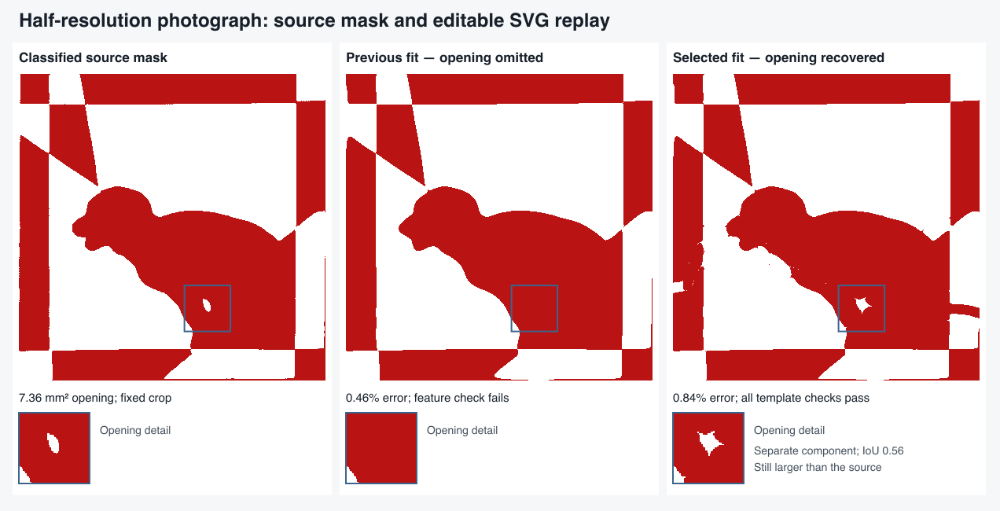

# Small features, spline initialization and editable exports

This follows the [feature-checkpoint study](FEATURE-CHECKPOINTS.md) through the
rest of the pipeline. The half-resolution puppy photograph retains its small
white opening after classification, but the previous feature initializer finds
no acceptable starting template. This is a template-fitting failure exposed by
an image perturbation; changing the crop detector alone cannot resolve it.

## Selected change

The ordinary feature search still uses 16 spline controls and the same bounded
slit-count proposals. If both that search and its adjacent joint-count retry fail
to retain a small interior region, it retries the original count proposals with
32 controls. The retry must retain the source features and represent the opening
as a separate component, rather than a channel to the background. Only the first
qualifying seed receives the ordinary fine-grid, clearance and free-curve stages.
Existing coarse feature starts keep their established route.

The selected spline dimension now follows the seed through both grid-fitting
stages. A parameter array of the wrong length raises an explicit error instead
of being silently interpreted with a different spline dimension. Fine and
clearance reports record their number of controls.

This changes initialization capacity, not the crop, classification, source mask,
3% error limit or physical acceptance rules. No saved templates enter the search.
The original ordinary finalists remain available if the extra layout fails.
Whole-component measurements are shared between fitting and QA, with tests
showing why retaining every source feature pixel can still hide an oversized
opening or an unwanted connection to the background.

## Root-cause experiments and rejected alternatives

All initialization experiments use frozen source masks. The production reruns
start from the original photographs with frozen crop coordinates; perturbations
change those coordinates or image pixels before classification.

Increasing the spline controls can recover an opening-preserving initializer
without increasing slit counts. Increasing raster resolution alone is less
reliable. This identifies the initializer's curve parameterization as a
bottleneck; it does not prove that no useful 16-control fit could exist.

Adding a weighted halo around the opening often eliminates the useful seeds.
Stronger feature weights can preserve pixels while inflating the opening or
joining it to the background. Those changes are not selected.

**More flexible curves also create new failure modes.** A broader 32-control
retry, including existing coarse fits whose opening is connected to the
background, passes all four perturbations through the engine. The horizontal
one-pixel shift then fails production editable conversion, even with zero
simplification tolerance. It is not a fourth end-to-end success.

That rejected pair has three short self-returns with approximately 0.81, 1.28 and
1.26 mm clearance, reached after 4.65, 6.81 and 13.77 mm of travel along a cut.
The engine's self-clearance audit excludes a neighbourhood of roughly 20 mm along
the same cut. The editor catches these shorter returns. The existing short-return
repair targets sharp joins and does not catch all returns spread over smooth
cubics. Editor segment-adjacency exemptions are another source of disagreement;
simply shortening the engine's exclusion also flags previously accepted shapes.

The following trials therefore remain rejected:

- A 24-control retry: all four engine checks pass, but two editable conversions
  fail.
- Stronger curvature penalties: several fits improve their image score without
  resolving the horizontal-shift export failure. More segments weaken the
  normalized curvature cost, but correcting that scaling alone is insufficient.
- A shorter self-clearance exclusion during finer refinement: the horizontal
  case loses its opening again.
- Local geometric shortcuts, with and without refinement: some repairs improve
  individual curves, but do not consistently remove all editor failures within
  the existing cleanup budget.

The selected retry is deliberately narrower: it adds capacity when there is no
coarse feature seed. The horizontal-shift case remains unresolved on the existing
route. A broader rollout needs subdivision-consistent return geometry checks and
constraints that retain the opening while preventing the narrow returns.

## Short-return validation

The full dataset replay also caught an ordinary 16-control gift fit that passed
engine checks but failed editable conversion. It never used the finer feature
retry. A slightly different deadline checkpoint had about 1.47 mm clearance
after an 8 mm same-cut detour. The prior run's nearby fit exported successfully.
Thus the initial 21/31 engine count was only 20/31 after editable replay.

The engine now supplements its long-range self-clearance check with a check of
nearby non-adjacent cubic spans. It uses the editor's 1.5-unit margin, bounded by
the requested paper clearance, within the previously excluded arc neighbourhood.
Spans less than twice that margin apart along the cut remain exempt from this
supplement. Actual Bézier points confirm each deficit; a close flattened chord
alone cannot establish it. The nearest pair on the complete cubics is assessed,
rather than arbitrary nearby samples around a bend.

The spatial broad phase emits pairs in left-to-right position order, which can
oppose their order along a cut. The supplement now restores path order before
testing adjacency and arc separation. A reflection regression exposed the bug:
one reflection of the captured anchor originally reported no return at all.
All four axis reflections now report the same clearance deficits. Existing
regular and hard-photo release geometries still pass this added check.

This runs in the existing geometry checkpoints, so an illegal lower-error fit
cannot replace a legal candidate. The MILP path also detects these returns
before publishing an incumbent and adds a no-good constraint for the offending
edge chain. A regression exercises that exclusion with the actual HiGHS solver.
In the focused fresh gift rerun, the final pair
passes editable conversion and paper replay at 2.52% disagreement. The existing
anchor repair remains valid, and an unrepaired anchor is now rejected by the
engine as well as the editor.
The final full-corpus replay also exports the gift successfully, at 2.32%.

This is a bounded addition, not complete equivalence between the two validators.
Adjacent cubics, very short bends and numerical details still follow their
existing checks. Final editable conversion remains mandatory.

## Validation

The frozen-crop perturbation replay improves from **2/4 to 3/4** complete
successes, including production editable conversion, SVG serialization/parsing,
editor geometry rules and the independent paper re-audit. The horizontal crop
shift still loses the opening and remains a failure; all four pairs are editable.
The vertical shift retains exactly the same editable-image score; the JPEG
variant changes from 1.596% to 1.631%.

For the half-resolution input, editable disagreement changes from 0.464% with the
opening absent to **0.838% with it retained**. Its component overlap is 0.560; it
covers 96.4% of the source opening and stays separate from the background. Its
area is 12.43 mm² versus 7.36 mm² in the source. Visual review also shows a more
pointed opening and extra irregularities along parts of the outline and frame.
This is a partial reconstruction improvement, not recovery of the exact design.

The full automatic-crop benchmark remains **21/31**, with no lost success and
identical crop coordinates, classification hashes and fitting-input hashes.
The inventory still includes 16 excluded incomplete/obscured entries and three
complete photographs without a crop; those three remain failures in the 31.
All 28 produced pairs pass editable conversion, SVG round-trip and the editor's
geometry rules. The seven reconstruction failures remain failures after that
conversion; an editable template does not imply a faithful reconstruction.

The remaining failures fall into these measured groups:

- No crop: nested squares, Santa, and the separate outlined-star photograph.
- Under 3% disagreement but missing a source feature: the collage outline star
  and crossed ribbons.
- Above 3% disagreement: bird, jigsaw, bauble, Stonehenge and Viking. All except
  jigsaw also lose at least one measured source feature.

These groups identify the failing gate, not the complete physical cause. The
fixed-input experiments establish fitting failures for the perturbed puppy;
they do not establish that every difficult crop or classified mask is correct.

At the separate 25-second search allowance, bird, crown, puppy and Stonehenge all
pass independent editable replay, at 2.42%, 2.38%, 1.18% and 2.48% disagreement
respectively. In particular, bird and Stonehenge recover without recropping or
changing classification. This supports a search-budget/initialization limitation
for these runs, rather than a crop failure that necessarily prevents recovery.

All **22 regular Hunodan designs** retain byte-identical exported cut geometry
and unchanged image error. Their slowest preparation + solve + validation + export
is **9.015 seconds**; decoding and independent replay are outside that timer.

The focused regression starts from the original half-resolution photograph,
checks its pixel and classified-mask hashes, then fits fresh templates. It checks
that the 32-control seed survives both grid stages, the opening remains separate,
its whole-component intersection over union exceeds 0.5, and independent export
disagreement remains below 1.2%. The source arrays must remain unchanged.

The failed-routing time-budget regression now uses the frozen outline-star
photograph. The half-resolution puppy no longer exercises failed tracing, so
keeping that old expectation would mistake a recovered feature for a regression.
The outline-star test still requires a legal, refined fallback after unsuccessful
traced recovery.

## Actual browser uploads: an unresolved shape failure

The browser replay passes **10/12** cases across Chromium and WebKit: original
puppy upload, frozen bird mask, frozen gift mask, independent free-border hat and
star in each browser. Both additional Stop replays also retain a valid editable
pair. These exercise the worker, editable SVG download, editor rules, source
fidelity, paper re-audit and PDF workflow.

The two failures are the new **half-resolution photograph uploads**, with fresh
automatic crop detection and the browser's own mask preparation. They are not
the fixed-crop, 390-cell perturbation above: the browser uses a newly detected
quadrilateral and a 400-cell mask. Both browsers produce a nominally valid pair
whose small opening connects to the background. Pixel retention exceeds 90%,
yet the matched component is roughly 4,515 mm² instead of 7.56 mm². The new
whole-component assertion catches this despite the engine claiming success.

Inspection of the exact browser mask shows both already-computed feature seeds
start with closed, oversized openings. Refinement can open the selected one;
the existing checkpoint preference protects its pixels, not its enclosure.
This is a production fidelity-check limitation, not an editable conversion
failure. It remains unresolved in this release and must not be counted as a
successful reconstruction.

Isolated diagnostic trials leave the original mask and production code intact.
A closed-component checkpoint preference alone still ends with the open
fallback. Selecting the other existing seed produces a closed opening at about
1.05% mask disagreement, but its whole-component overlap is only 0.447, below
the browser regression's 0.5 requirement. This identifies a useful alternate
route without yet establishing a production fix. No forced seed ordering is
shipped.

One further diagnostic applies the existing local feature-detail refinement to
that alternate route. Its independently replayed editable pair passes the editor
and paper checks at **0.903% disagreement**, with a closed opening of 9.69 mm²,
99.2% source retention and **0.769 whole-component overlap**. Applying the same
detail refinement to the originally selected route still leaves the opening
connected to the background. The alternate result demonstrates that this exact
mask admits a substantially better pair, but the experiment forces the alternate
seed order and is not a production candidate-selection policy. The next change
needs to find and select it within a bounded search, preserve its enclosure
through refinement, and reject false shape successes without regressing the
existing datasets.

All **855 application tests** (one existing skip) and **580 inverse tests** pass.
Type checking reports zero errors and seven existing warnings; lint and build
pass. The failing new browser cases are reported separately, not hidden by
those successful automated checks. See the [measurement ledger](FEATURE-RESOLUTION-VALIDATION.json).
The local preview serves 65 checked engine/worker JavaScript assets with hashes
identical to the source tree. No changes were pushed or deployed.

Dataset, editable-export and browser measurements are recorded separately from
these focused tests. A low mask error or an engine-only pass is not an editable
template success. Paper measurements remain nominal geometric checks; these
templates have not been physically assembled.
