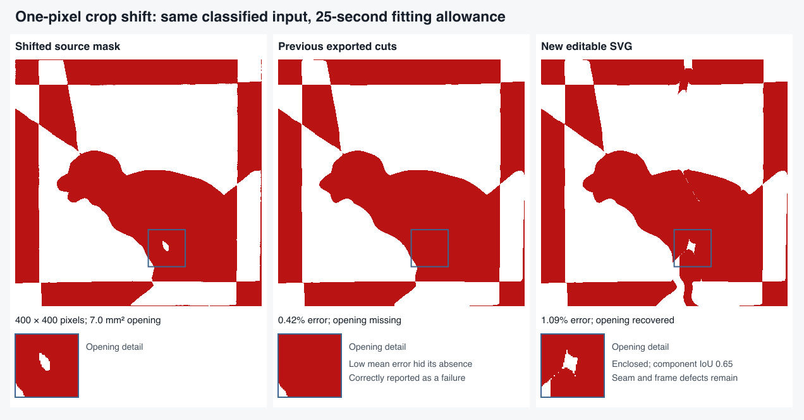

# Recovering an opening after a one-pixel crop shift

This continues [the enclosure investigation](FEATURE-ENCLOSURE.md). Its remaining
horizontal-shift failure was in template fitting: the unchanged classified mask
contained a substantial opening, but the final woven result erased it. Moving
all four crop coordinates one pixel horizontally is enough to trigger this case.
The runtime change is committed as `af43639`; the
[validation ledger](FEATURE-RETRY-VALIDATION.json) records per-case results,
source hashes and browser evidence.

## Where the pipeline failed

The feature initializer already computed two layouts that retained the opening.
Refinement of the first lost it. The previous alternate-layout retry only ran
when a region joined the background, so a completely missing region could not
use that second layout. Extending the allowance to 25 seconds still failed.

Reusing that existing second layout preserved the opening at 1.115% image
disagreement, but its paper-support audit remained uncertain at both 360 and
700 cells. Rechecking the same coordinates was insufficient. It was correctly
ineligible for a successful result.

The existing local detail refinement could move this geometry into a verified
paper pass. Its image disagreement was initially 1.169%, an increase of 0.054
percentage points from the uncertain proposal. The fitter rejected that increase
as though the uncertain proposal were an accepted incumbent. It then returned
the 0.4% ordinary fit with the opening completely missing.

## Change

The fitter may now reuse one existing feature layout when refinement either
erases a region or opens it to the background. It adds no slit-count hypotheses
and keeps the ordinary candidates and original time allowance.

A geometry-valid, paper-uncertain feature layout can receive the existing short
detail refinement. Only the resulting independently verified geometry can be
accepted. It must still pass the original image-error, feature, geometry and
paper checks. Refining an already accepted incumbent cannot increase its image
error; an unverified proposal has no such incumbent status.

The original pixels and probabilities are unchanged. The regression starts from
photograph pixels and the shifted crop, with no saved cuts, and checks both 400-
and 800-cell independent exported-weave renderings. The alternate's uncertainty
and the subsequent finer-resolution pass remain inspectable in the report.

## Validation

The first complete photograph → classification → fit → editable SVG replay
passes at 1.089% editable disagreement. The opening retains 99.1% of its source
pixels and remains enclosed, with whole-component IoU 0.649. Solve, validation
and export take 21.13 seconds with a 25-second search allowance. This does not
establish a ten-second solution for this hard case.

Visual inspection still shows an oversized, angular opening, a thin broken seam
across the body and defects in the surrounding frame. Those defects are not
hidden by the successful feature and geometry checks. This is an improvement
in recoverability, not an exact reconstruction or a physical assembly test.
Shared-cut cleanup accepts seven exact alignments in this result and rejects
five proposals for failing paper checks; simply forcing all nearby cuts together
would bypass those constraints.

An additional independent rendering check at 400, 800, 1600 and 3200 pixels keeps
the opening separate at every resolution. Its component IoU ranges from 0.628
to 0.638 in the engine-exported cuts; these differ slightly from the editable SVG
measurement above. Total disagreement increases from 1.089% to 1.278% at the
highest resolution, where more subpixel seams become visible. These are raster
measurements, not an exact continuous-topology certificate.

All 855 application tests (one existing skip) and 585 inverse tests pass. Type
checking has no errors and seven existing warnings; lint and build pass.

The 22 regular Hunodan designs retain byte-identical cut geometry and exactly
unchanged errors. All pass their ten-second gate; the slowest is 9.09 seconds,
including preparation, solve, validation and export but excluding decoding and
independent replay.

The ten-second hard-photo replay remains 21/31, with every previous success
retained and all 28 produced pairs editable. All crop, classified-mask and
fitting-objective hashes match the preceding run. The fixed-crop perturbation
replay remains 3/4 at ten seconds: the horizontal shift is still a failure at
that budget. The new 25-second replay is reported separately above.

All **14 actual browser workflows** pass in Chromium and WebKit: original and
smaller puppy uploads, the shifted mask, bird and gift masks, independent free-
border hat and star. Both **Stop during detail refinement** workflows also pass,
including editable export and paper revalidation, in 3.73–3.78 seconds from Stop
to ready. All 65 served core/worker JavaScript files match the tested workspace.

For the shifted mask, actual click-to-ready latency is 21.93 seconds in Chromium
and 23.96 seconds in WebKit. Both editable outputs have 1.092% source disagreement,
but their opening IoUs differ: 0.649 and 0.603. The browser harness verifies the
same classified pixels and measures shape separately from global error. The
25-second Node experiment and these browser timings measure different workflows;
neither is a ten-second speed claim.
