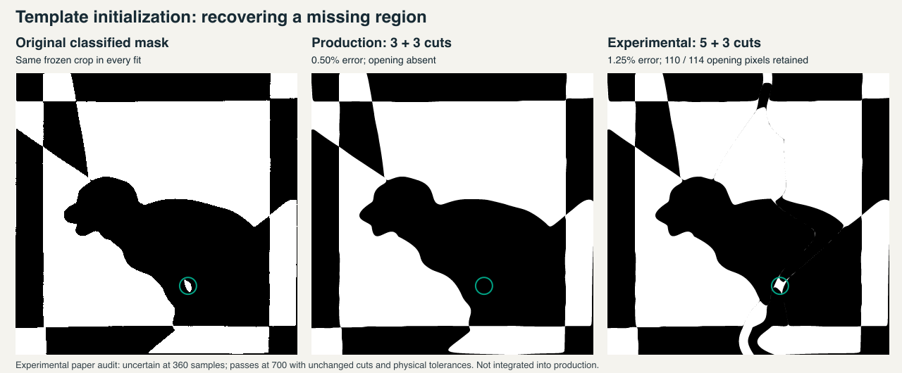

# Full pipeline replay and feature-preserving starting layouts

2026-10-12. Production engine: `877c62e`; mask-track benchmark: `eb14ce9`.
The production score remains **11/31**. This study improves the measurement
coverage and identifies a promising template-initialization candidate; it does
not install an experimental search or alter acceptance thresholds.



## Replay the actual imported mask

`hard-photo-benchmark.mjs --target=mask` now follows photograph → automatic crop
→ classification → fresh binary-mask preparation → fitting → geometry and paper
checks → export → independent SVG rendering. The separate editable replay then
uses production conversion, SVG serialization/parsing, editor intersection rules
and a second mask comparison. It complements the existing browser upload tests;
it does not simulate browser interaction or the app's longer search allowance.
These corpus runs also request no enforced symmetry; the app can enable detected
symmetries when importing a mask. That choice remains a separate browser concern.

The new track retains all 47 inventory entries, including the 31 complete hearts.
At a ten-second solver allowance:

| Outcome | Complete hearts |
| --- | ---: |
| Accepted | 11 |
| No automatic crop proposal | 3 |
| Above 3% error, with source features retained | 9 |
| Below 3% error, but missing a substantial region | 3 |
| Both excessive error and missing regions | 5 |

All 28 produced pairs pass geometry and the default paper audit. All 28 also
survive editable SVG conversion without editor issues or conversion-fidelity
failures; the same 11 remain accepted. No previous accepted case becomes a failure.
The three low-average-error failures are the outlined star, crossed ribbons and
puppy. Fourteen of the 17 unsuccessful fits lack consistent opposing-edge count
evidence; the puppy, Stonehenge and Viking have consistent counts but still fail.
Most failed fits also have substantial interior error. These observations do not
prove that their crops are correct, but show why crop detection alone cannot be
the improvement target.

Every imported mask and fitting probability field matches the previous photo
benchmark byte for byte. **Default Lab/Otsu classification is already binary.**
The earlier claim that the puppy had a continuous photo objective was incorrect
and is corrected in [the scheduling report](REFINEMENT-SCHEDULING.md). Explicit
mixture classification is different; a regression checks that importing its mask
preserves every classified pixel while replacing its continuous probabilities.
Both tracks now record fitting-input hashes instead of inferring this distinction.

Wall-clock-limited solves can still yield different errors on identical inputs.
For example, this replay's bauble is 9.365% versus the earlier 6.994375%; both fail.
The ledger retains every result, including these differences. It is not evidence
that binary re-preparation changed the objective or that the algorithm improved.

## Template initialization experiment

The frozen puppy mask contains a 114-pixel white opening between its legs. The
production fit omits it despite only 0.49625% independent error. The earlier
gradient ablation showed that filling these pixels changes **none** of that
candidate's boundary-gradient entries: its cuts are too far away for local
refinement to feel the region.

The experimental initializer weights substantial source regions more heavily
during row dynamic programming. It does not change the photograph, crop, mask,
probabilities, geometry rules or final scoring objective. Each weighted seed is
rescored against the original unweighted target. For this diagnostic only, the
three lowest-error feature-retaining seeds receive ordinary downstream fitting;
this deliberately isolates their ability to recover the opening. It is not a
production policy that preserves the original finalists.

Two count policies were examined, both with both colour phases:

- Existing hypotheses, emphasizing the opening by 64× or 256×. The 64× fit uses
  7+7 cuts and retains the opening at about 2.5% error, but visibly distorts the
  border. Stronger weighting produces a roughly 7.4–7.7% fit which loses it again.
- All count pairs from 2 through 5, emphasizing the opening by 16× or 64×. The
  16× initializer finds a 5+3 routing. The exported fit has **1.246875%** error,
  retains **110/114** opening pixels, and keeps that opening in an isolated
  199-pixel component. The corresponding editable SVG has **1.269375%** error,
  no editor issues and no conversion-fidelity regression.

The 16× experiment takes 8.82 seconds for the photo target and 7.23 seconds for
the re-prepared mask, including fitting, final checks and independent rendering,
but excluding initial photo preparation, artifact writes and the later finer
paper probes. These are isolated Node measurements with a 20-second allowance,
not a ten-second production or browser guarantee. Both runs produce the same
error and region retention. The 64× unequal-count fits are worse at 1.68625%.

The 5+3 candidate still adds a curved feature at the lower border and thin seams.
Retaining the small region is useful progress, not ground-truth recovery. The
original cutting paths are unknown, and region retention does not certify the
entire design's topology.

## Paper uncertainty is a separate obstacle

All weighted 5+3 candidates pass nominal geometry but receive `uncertain` from
the standard 360-cell rolling-disk paper audit. Checking the **same exported
coordinates** more finely gives:

| Weight | 360 cells | 540 cells | 700 cells |
| --- | --- | --- | --- |
| 16× | uncertain | uncertain | pass |
| 64× | uncertain | pass | pass |

This holds for both photo and mask runs. Physical width, minimum remaining width,
cut error, print shrinkage, geometry tolerance and minimum feature area stay
fixed; only the paper grid and its associated conservative guard change. No
`uncertain` result is relabelled as a pass. The production policy is unchanged.
The finer pass is evidence about the guarded disk model, not physical assembly.

Together these experiments suggest two changes to investigate: additional
feature-preserving routings without displacing viable original starts, and a
bounded finer audit for promising candidates whose coarse paper result is
uncertain. Both need testing across the other failures and the 22 fast regular
designs before changing the main search.

## Evidence and reproduction

[Complete measurements](FEATURE-SEED-VALIDATION.json) include source and fitting
hashes, all 31 outcomes, all 28 editable replays, all eight weighted experiments,
their finer paper audits, feature connectivity and eight experimental editable
replays. None of the experimental candidates counts as a production pass.

```sh
node scripts/inverse/hard-photo-benchmark.mjs --target=mask --seconds=10 --output=tmp/hard-corpus-mal-mask
node scripts/inverse/hard-photo-editor-replay.mjs --run=tmp/hard-corpus-mal-mask --output=tmp/hard-corpus-mal-editor
node scripts/inverse/feature-seed-study.mjs --output=tmp/feature-seed-default-replay
node scripts/inverse/feature-seed-study.mjs --counts=unequal --output=tmp/feature-seed-unequal-fit
node scripts/inverse/feature-seed-validation.mjs --run=tmp/feature-seed-default-replay
node scripts/inverse/feature-seed-validation.mjs --run=tmp/feature-seed-unequal-fit
```

The new benchmark regression and complete test suite pass: 851 application tests
(one existing skip) and 556 inverse tests. Type checking has zero errors and seven
existing warnings; lint and production build pass. Runtime application and solver
code are unchanged in this study. After rebuilding and restarting port 5232,
Chromium and WebKit also pass the free-border independent-hat workflow, including
editable SVG download. Their click-to-ready times are 5.95 and 6.19 seconds.
Served page and fitter hashes match the local build and source.
