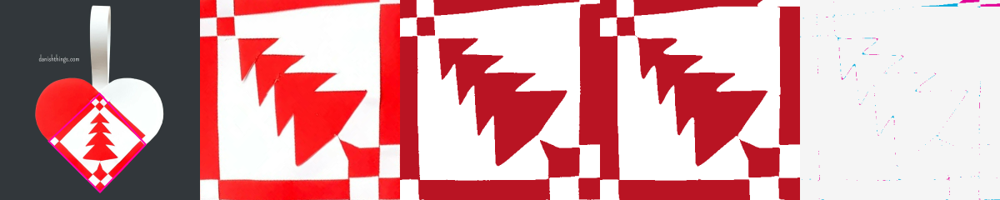

# Photo-to-template diagnosis

## Coordinated shared-path cleanup (2026-10-19)

`direct/shared-shortening.js` can slide both junctions of a shared cut along
the visible boundary at once. It splits the original cubics exactly and
reassigns the consumed pieces between sheets. Both sheets reference the same
new connector. It tries a straight shortcut and a deformation of the existing
route, rejecting intersections, inadequate clearance, changed symmetry,
changed woven masks, increased source error, or either paper-core failure.
Pinned endpoints and independent coincident branches cannot move.

The production finalizer runs this optional search only with more than two
seconds of otherwise unused time, preserving the existing export reserve.
The candidate search takes at most 400 ms; at most two candidates proceed to
complete checks. An already started final paper audit must finish before a
result is returned. This is a local improvement, not a shortest-path guarantee.

The deterministic real Viking regression shortens a shared route from
15.0751 mm to 14.7543 mm, with unchanged reported source error (1.761875%),
passing geometry and both paper checks. Independent 800-pixel rendering has
three antialiased threshold ties and mean coverage difference 0.00000451;
exact cubic subdivision does not promise byte-identical raster antialiasing.
Synthetic tests also cover curved boundaries and reversed shared paths.

Ordinary polishing now uses the independent offset paper check and recovery
forces, previously restricted to outline-detail polishing. On a separate saved
rejected Viking fit, equal 160-step refinement changes independent error from
1.7925% to 1.77625% and repairs the disconnected paper core. A finer lattice
check can no longer override a known offset failure. Shared-run discovery and
paper-defect classification are extracted into common helpers.

Timed fresh comparisons against `9e68605d` did not establish an aggregate
quality or speed improvement: both versions passed five of six template
cases. The bicycle candidate lost refinement time in unchanged initialization
stages under variable machine load and remained a feature failure in both.
The fixed-work regressions establish the local improvements; broader timed
benchmark misses remain recorded rather than relaxed.

The October 19 full inverse run passed 1,140 of 1,150 tests, including the new
fixed-work paper and shared-junction regressions. Seven time-limited benchmark
assertions missed their existing thresholds (border-fragment routing, stacked
motif retention, two feature-finalist cases, smoother photograph retry,
photographed checker, and synthetic-control routing). Two real-clock admission
tests subsequently passed an isolated five-test replay. The remaining failure
was an old physical-crop assertion while the experimental inset default was
enabled; that default was withheld and all 12 focused original-crop/helper
checks pass. The [paired crop study](datasets/photo-edge-inset-study.md) records
the reason. No benchmark thresholds were loosened and this is not a claim that
the entire timed benchmark suite is green. Final application checks pass
1,596 tests with one existing skip; type checking, lint, static build and the
new Paint/archive Chromium workflows pass.

Reproduce the focused geometry and paper checks with:

```sh
node --test --test-concurrency=1 scripts/inverse/shared-shortening.test.mjs \
  scripts/inverse/shared-simplification.test.mjs scripts/inverse/polishing-offset.test.mjs
```

## Earlier photographic study

This check follows source pixels through automatic crop detection, colour
classification, cut-count initialization, refinement, template checks, export,
and an independent resvg rendering of the exported curves. It covers eight
web-photo selections and both supplied orange photographs, with automatic and
manual diagnostic crops for the latter. Source fixtures were already committed;
no reference cutting paths enter the solver.

[Measurements](FULL-PIPELINE-VALIDATION.json) retain the exact crop coordinates,
pass/failure stages and candidates. A passed template check is not a claim of
recovering the original artwork or of physical assembly.

The later [lobe-shape study](LOBE-SHAPES.md) adds known-artwork comparisons
through exported templates, and an automatic crop-to-export track for all 22
regular Hunodan photographs. It distinguishes a good fit to a distorted crop
from recovery of the original motif.

## What the failures actually show

The two automatic orange crops pass at **1.65% and 1.51%** mask disagreement
with the normal 60-second budget, returning in 12.6–12.9 seconds including
preparation, validation and export (detection measured separately). An earlier
five-second experiment cannot establish their normal-budget failure.

The manually annotated crop of the smaller orange upload fails feature
retention despite **1.48%** disagreement and passing geometry/paper checks. Its
classified mask includes a small pale region in the glossy highlight and a
coloured fragment near the bottom edge. Both are counted as protected interior
regions. The original mask and the warning remain intact. This is distinct from
a failed crop proposal or a high whole-image fitting error.

The initial eight web selections with a ten-second fitting budget produced six candidates
passing the existing checks, one candidate needing review (red/white tree), and
one missing crop (angel). Visual inspection of the blue/green checker confirms
that its cells now survive classification; the earlier stripes-only conversion
is no longer present. The green/blue tree passed numerically at 2.65%, but its
branch tips remained rounded. Component retention and a whole-image average do
not fully describe that loss of local detail. A subsequent
[coarse-routing improvement](COARSE-TOPOLOGY.md) restores those branches through
the same curve fitter and fixes the order of repair and matching-sheet selection.
That report contains the newer measurements and regression evidence.

## Search and crop distortion are separate contributors

The red/white tree's fixed automatic crop and mask preserve its branches. The
previous fitter returned the same **7.02%** error with either a 10- or 60-second
budget. The 60-second request returned after 16.94 seconds.

Two routes fail for different reasons:

- The mixed-boundary initializer rejects its 0.58% tracing error at the 0.5%
  initialization threshold. The separate feature-recovery trace encounters
  three start transitions versus four end transitions before MILP search.
- Grid refinement tries only three ranked seeds. The closer five-cut candidates
  fail paper-support checks. The accepted four-cut geometry rounds away branch
  detail. Extending the time on these same candidates does not recover it.

The fitter now tries further already-initialized layouts when all three initial
candidates fail the original image/feature/paper checks and the requested budget
still leaves time for refinement and finalization. Successful fast-path cases
stop as before. Candidate acceptance and all geometry checks are unchanged.

On the unchanged tree crop and mask, this yields a three-cut candidate at
**3.45%** disagreement with passing geometry and paper checks. Total runtime is
60.98 seconds, including preparation and export. It still exceeds the 3% image
limit and loses a small edge feature, so it is correctly marked for review.
Several lower-error candidates remain rejected for paper support. This is an
improved fallback, not a solved tree or a new corpus-wide success claim.

Columns: original/crop outline, rectified photograph, classified mask,
independently rendered templates, difference.


A subsequent controlled crop replay changes that diagnosis: cropping is also a
major contributor in this example. A visually annotated overlap square, fixed
before fitting, gives **0.75%** disagreement and passes the image, feature,
geometry and paper checks with the ten-second solver budget. The four corners
are saved in `scripts/inverse/fixtures/web-photos/tree-diagnostic-crop.json`.
They are diagnostic annotations, not surveyed ground truth. Each crop produces
a different classified target, so its percentage is not directly interchangeable
with the automatic crop's percentage. Adjusting only the top notch still fails
at 6.12%; inset corners fail at 8.72%.



The published [tree template](https://danishthings.com/wp-content/uploads/2022/11/Danish-Things-Julehjerte-med-juletrae-1.pdf)
has three full-length slits per sheet, including a sharp zigzag. This is a
supported regular design. An approximate straight-span annotation of it,
rendered into a clean mask, is recovered from pixels alone at **0.15%** error
in 1.53 seconds of solver time. No reference paths enter the fitter. This
isolates a case the main fitter can solve from distortions introduced by the
photograph, cropping and classification; it is not an exact digitization of
the published template.

## Small edge perturbations should not imply extra cuts

Changing only **20 of 160,000 pixels (0.0125%)** along the clean tree's edge
previously produced five inferred endpoints on one side and three on the
opposite side. The topology initializer rejected it before MILP search; two
tested orientations then took 9.14–9.79 seconds through grid refinement.

When opposing endpoint counts disagree or endpoint spacing is too narrow,
the initializer now tries progressively wider inward border profiles. It
accepts the smallest proposal that retains the original features and differs
from the original mask by at most the existing 0.5% initialization limit.
The candidate still has to pass the normal geometry and paper checks. The
original mask, cached raw trace and final accuracy reference remain unchanged.
Weighted/free-border artwork keeps its existing guide.

All four perturbed sides now recover **three cuts per sheet**, pass all checks,
and independently render at **0.16%** disagreement against the noisy input.
Measured prepare/solve/export/replay times are 1.39–3.36 seconds. The regression
also covers swapping the two colours and rejecting repairs under a stricter
error cap. This fixes a template-initialization weakness; it does not repair
the automatic tree crop or establish robustness to every photographic defect.

## Matching cuts and invisible seams

A separate template-stage bug paired cuts inconsistently. The diagnostic could
recognize reordered sheets as identical, while the optimizer and shared-seam
repair still used serialized array indices as partners. Reversed traversal
could also confuse the diagnostic's boundary ordering.

Comparison, averaging, optimization ties, and matching-sheet seam replacement
now orient each cut toward its opposite edge and pair cuts by physical boundary
position. The original input is not mutated. Regressions cover a reversed,
reordered pair and the real free-border hat fixture with shuffled paths. The
hat test checks exact shared geometry, retained template symmetry, geometry and
paper checks, and reduced seam error in independently rendered exports at four
times the source resolution.

A replay of the prior seam-repair implementation on that shuffled hat retained
zero exactly shared length. The repaired implementation retains 215.17 mm and
reduces the independently rendered fractional-coverage error from 3.0885% to
3.0621%. The small area change matters because a long, thin seam occupies few
pixels; this fixture isolates seam repair rather than claiming a new photo fit.

## Regression checks

These measurements describe the border-recovery iteration. The subsequent
[coarse-routing report](COARSE-TOPOLOGY.md#validation) records the newer checks.

All 842 application tests and 518 inverse-engine tests pass, with one existing
application-test skip. Type checking reports zero errors and seven existing
warnings; lint and the static build pass.

The 22 regular Hunodan photographs still pass the frozen benchmark criteria.
Median prepare/solve/validate/export time is 5.30 seconds, with a maximum of
8.55 seconds. All 22 independently rendered errors are exactly unchanged from
the preceding count-selection replay. This is a serial Node measurement;
browser startup and editor conversion are measured separately in the ledger.
The eight automatic web-photo outcomes and errors are also unchanged by the
border recovery: six pass, the red tree needs review, and the angel has no crop.

Fourteen production-browser workflows pass: the star, matching/independent/Anti
hats, an automatically cropped Hunodan photograph, a noisy checker and a noisy
tree in both Chromium and WebKit.
They exercise the worker, editable conversion, editor issue checks and downloads.
The checker retains its edge defect and fits through grid initialization. The
tree retains defects on two edges and exercises the new topology recovery in
the real worker, with three cuts per sheet and 1.75–1.79 seconds from clicking
Find to the editable result being ready. Both cases verify the uploaded noisy
endpoint counts, SVG/PDF exports, source fidelity and editor legality. The
tree's defect is symmetric so automatic import folding cannot remove it;
the checker uses unequal strip widths for the same reason.

The preview's served fitter, topology, matching and sharing modules match the source hashes.
Firefox could not be tested: its launch timed out after 180 seconds before any
page opened, with native sandbox-extension and framebuffer diagnostics. That
infrastructure failure is recorded separately from application outcomes.

## Reproduction

Run CPU benchmarks serially, without a simultaneous build or test run. For
browser replays, set `PLAYWRIGHT_MODULE` to an existing Playwright installation
if the package is not available locally:

```sh
node scripts/inverse/web-photo-benchmark.mjs --stage=solve --seconds=10 --ids=danish-tree-red,danish-tree-green,bibel-checker-2,bibel-checker-3,bibel-checker-4,bibel-narrow-wide,bibel-nested-heart-red,bibel-angel
node scripts/inverse/web-photo-benchmark.mjs --stage=solve --seconds=60 --ids=danish-tree-red
node scripts/inverse/web-photo-benchmark.mjs --stage=solve --seconds=10 --ids=danish-tree-red --crop-overrides=scripts/inverse/fixtures/web-photos/tree-diagnostic-crop.json
node --test scripts/inverse/edge-topology.test.mjs
INVERSE_HARD_CROPS=automatic-0,manual-diagnostic node scripts/inverse/hard-user-benchmark.mjs
INVERSE_TEST_CASES=noisy-checker,noisy-tree INVERSE_TEST_BROWSERS=chromium,webkit INVERSE_TEST_URL=http://127.0.0.1:5232 node scripts/inverse/paint-browser-test.mjs
```

Future web-photo runs record hashes of the actual engine, locator and benchmark
sources, including uncommitted changes. Earlier measurements above identify
their baseline commit and local artifact directories in the validation ledger.

Remaining work spans crop distortion, photographic classification fragments,
and sharp-feature recovery under paper-support constraints. These experiments
distinguish the stages: a better crop solves the photographed tree in the
diagnostic replay, while edge-noise recovery prevents tiny mask changes from
unnecessarily discarding an otherwise useful topology seed.
