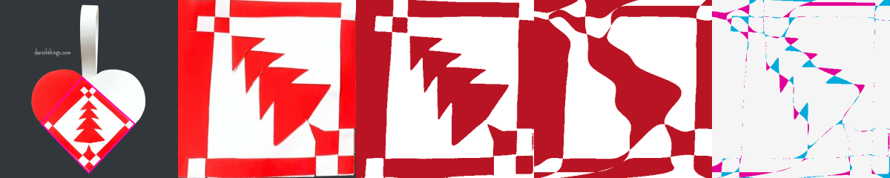
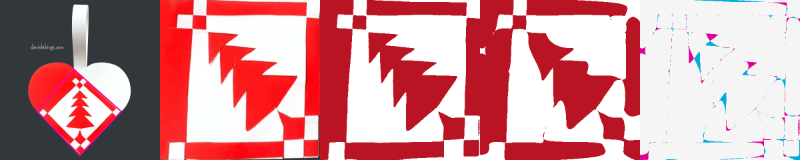

# Photo-to-template diagnosis

This check follows source pixels through automatic crop detection, colour
classification, cut-count initialization, refinement, template checks, export,
and an independent resvg rendering of the exported curves. It covers eight
web-photo selections and both supplied orange photographs, with automatic and
manual diagnostic crops for the latter. Source fixtures were already committed;
no reference cutting paths enter the solver.

[Measurements](FULL-PIPELINE-VALIDATION.json) retain the exact crop coordinates,
pass/failure stages and candidates. A passed template check is not a claim of
recovering the original artwork or of physical assembly.

## What the failures actually show

The two automatic orange crops pass at **1.65% and 1.51%** mask disagreement
with the normal 60-second budget, returning in 12.6–12.9 seconds including
preparation, validation and export (detection measured separately). An earlier
five-second experiment cannot establish their normal-budget failure.

The manually annotated crop of the smaller orange upload fails feature
retention despite **1.48%** disagreement and passing geometry/paper checks. Its
classified mask includes a small pale region in the glossy highlight and a
coloured fragment near the bottom edge. Both are counted as protected interior
regions. The original mask and the warning remain intact. This is distinct from
a failed crop proposal or a high whole-image fitting error.

The eight web selections with a ten-second fitting budget produce six candidates
passing the existing checks, one candidate needing review (red/white tree), and
one missing crop (angel). Visual inspection of the blue/green checker confirms
that its cells now survive classification; the earlier stripes-only conversion
is no longer present. The green/blue tree passes numerically at 2.65%, but its
branch tips remain rounded. Component retention and a whole-image average do
not fully describe that loss of local detail.

## A search failure beyond cropping

The red/white tree's fixed automatic crop and mask preserve its branches. The
previous fitter returned the same **7.02%** error with either a 10- or 60-second
budget. The 60-second request returned after 16.94 seconds.

Two routes fail for different reasons:

- The mixed-boundary initializer rejects its 0.58% tracing error at the 0.5%
  initialization threshold. The separate feature-recovery trace encounters
  three start transitions versus four end transitions before MILP search.
- Grid refinement tries only three ranked seeds. The closer five-cut candidates
  fail paper-support checks. The accepted four-cut geometry rounds away branch
  detail. Extending the time on these same candidates does not recover it.

The fitter now tries further already-initialized layouts when all three initial
candidates fail the original image/feature/paper checks and the requested budget
still leaves time for refinement and finalization. Successful fast-path cases
stop as before. Candidate acceptance and all geometry checks are unchanged.

On the unchanged tree crop and mask, this yields a three-cut candidate at
**3.45%** disagreement with passing geometry and paper checks. Total runtime is
60.98 seconds, including preparation and export. It still exceeds the 3% image
limit and loses a small edge feature, so it is correctly marked for review.
Several lower-error candidates remain rejected for paper support. This is an
improved fallback, not a solved tree or a new corpus-wide success claim.

Columns: original/crop outline, rectified photograph, classified mask,
independently rendered templates, difference.




## Matching cuts and invisible seams

A separate template-stage bug paired cuts inconsistently. The diagnostic could
recognize reordered sheets as identical, while the optimizer and shared-seam
repair still used serialized array indices as partners. Reversed traversal
could also confuse the diagnostic's boundary ordering.

Comparison, averaging, optimization ties, and matching-sheet seam replacement
now orient each cut toward its opposite edge and pair cuts by physical boundary
position. The original input is not mutated. Regressions cover a reversed,
reordered pair and the real free-border hat fixture with shuffled paths. The
hat test checks exact shared geometry, retained template symmetry, geometry and
paper checks, and reduced seam error in independently rendered exports at four
times the source resolution.

A replay of the prior seam-repair implementation on that shuffled hat retained
zero exactly shared length. The repaired implementation retains 215.17 mm and
reduces the independently rendered fractional-coverage error from 3.0885% to
3.0621%. The small area change matters because a long, thin seam occupies few
pixels; this fixture isolates seam repair rather than claiming a new photo fit.

## Regression checks

All 842 application tests and 502 inverse-engine tests pass, with one existing
application-test skip. Type checking reports zero errors and seven existing
warnings; lint and the static build pass.

The 22 regular Hunodan photographs still pass the frozen benchmark criteria.
Median prepare/solve/validate/export time is 5.04 seconds, with a maximum of
8.58 seconds. All 22 independently rendered errors are exactly unchanged from
the preceding count-selection replay. This is a serial Node measurement;
browser startup and editor conversion are measured separately in the ledger.

Ten production-browser workflows pass: the star, matching/independent/Anti hats,
and an automatically cropped Hunodan photograph in both Chromium and WebKit.
They exercise the worker, editable conversion, editor issue checks and downloads.
The preview's served fitter, matching and sharing modules match the source hashes.
Firefox could not be tested: its launch timed out after 180 seconds before any
page opened, with native sandbox-extension and framebuffer diagnostics. That
infrastructure failure is recorded separately from application outcomes.

## Reproduction

Run CPU benchmarks serially, without a simultaneous build or test run:

```sh
node scripts/inverse/web-photo-benchmark.mjs --stage=solve --seconds=10 --ids=danish-tree-red,danish-tree-green,bibel-checker-2,bibel-checker-3,bibel-checker-4,bibel-narrow-wide,bibel-nested-heart-red,bibel-angel
node scripts/inverse/web-photo-benchmark.mjs --stage=solve --seconds=60 --ids=danish-tree-red
INVERSE_HARD_CROPS=automatic-0,manual-diagnostic node scripts/inverse/hard-user-benchmark.mjs
```

Future web-photo runs record hashes of the actual engine, locator and benchmark
sources, including uncommitted changes. Earlier measurements above identify
their baseline commit and local artifact directories in the validation ledger.

The next fitting work should target sharp-feature recovery under paper-support
constraints and boundary-noise-tolerant topology initialization. Simply moving
crop corners or increasing time on the same smooth grids does not address
these failures.
