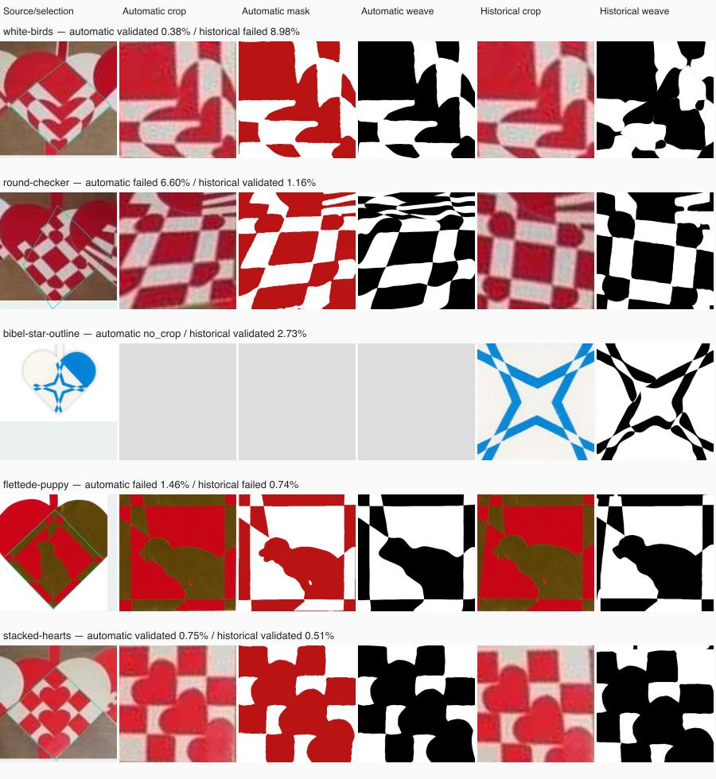

# Full-pipeline replay of the original 31 complete hearts

This is the historical baseline. See [the feature integration and export
QA](FEATURE-INTEGRATION.md) for the newer 16/31 result on the same masks.

The original hard-photo corpus is now committed and runs through the production
automatic cropper, colour conversion, automatic fitter, independent exported-SVG
renderer, editable conversion and SVG save/reload. This makes failures reproducible
without another worktree's temporary files. The engine is unchanged since
`58b50ba`; these measurements establish a broader baseline, not a new fitting gain.

## Inputs and comparison

The eight frozen photographs contain 47 annotated instances: 31 complete, 15
clipped and one obscured. Both file and decoded-pixel hashes are verified. The
collage PNG reproduces every byte of the historical RGBA input. Originating URLs
remain in the individual-photo catalogue. These are saved study captures, not a
claim that their PNG bytes match the original downloaded JPEGs.

Two serial runs use the same source pixels, production automatic fitter and
ten-second fitting budget:

- **Automatic:** only rough collage rectangles, or the entire individual photo,
  are supplied to the locator. Historical overlap corners never enter this run.
- **Historical fixed:** the earlier approximate corners/insets are supplied. These
  annotations were disputed and are not ground truth.

Different crops produce different classified targets. Their error percentages
cannot be interpreted as measurements against one common ground-truth mask.
Detection, preparation, validation, external rendering and artifact writing also
cost time; this is not a claim that every complete pipeline finishes within ten
seconds.

| Outcome | Automatic | Historical fixed |
| --- | ---: | ---: |
| Complete motifs in denominator | 31 | 31 |
| Passing reconstructed pairs | 11 | 15 |
| Generated pairs needing review | 17 | 16 |
| No crop proposal | 3 | 0 |
| Generated pairs passing geometry | 28/28 | 31/31 |
| Generated pairs passing guarded paper checks | 27/28 | 27/31 |
| Pairs losing protected source regions | 8 | 7 |
| Pairs above 3% independent mask error | 15 | 10 |
| Successful editor/SVG replays | 28/28 | 31/31 |

Feature loss, high error and uncertain paper checks can overlap. Missing crops
remain failures among the 31 complete cases. All proposals require visual review.
Passing here requires the existing image, source-feature, geometry and paper
checks; it does not establish correct cropping, published cutting-path recovery,
artistic quality or physical assembly.

Seven cases pass only with historical corners: gingerbread, round checker, orb,
jigsaw, maple leaf, crossed ribbons and the individual outlined star. Three pass
only with automatic corners: white birds, flower and faceted star. Eight pass
under both. Supplying the historical corners is therefore neither a universal
correction nor sufficient to resolve the remaining reconstruction failures.

## What the images and intermediate stages show

All 31 complete cases were inspected side by side. This selection shows successes,
crop differences and a template-specific failure:

**Crop detection remains one cause.** Nested squares and Santa produce no
automatic proposal because the locator cannot identify both exposed lower paper
edges. The individual blue/white outlined star is rejected as a crowded frame
despite containing one heart. The automatic round-checker proposal visibly
includes the wrong overlap region. Conversely, some historical corners distort
white birds, flower and faceted star more than the automatic proposals do.

**Template reconstruction loses real features even with a clear mask.** The puppy
is the strongest control: both classified masks retain the small opening between
its legs, but both fitted template pairs fill it completely. The missing feature
is 7.125 mm² in the automatic target and 7.875 mm² in the historical target, at the
nominal 100 mm overlap size. Independent exported-mask disagreement is only
1.458125% and 0.73625%, respectively. Geometry and paper checks pass, but the
source-feature audit correctly rejects both reconstructions. This loss occurs
before editor conversion and cannot be explained solely by the cropper or by
colour classification erasing the opening.

Stonehenge and Viking similarly retain fine structure in their masks that the
fitter rounds off or loses. Their detailed routing, cut-count selection and
refinement remain investigation targets; these observations do not prove that
their original designs are impossible under the current geometry rules.

**A small aggregate error can hide a visibly important loss.** The collage's
`outline-star` under historical corners also falls below 1% while missing a
protected region. Other
sub-3% results have uncertain paper support. Such cases stay unsuccessful; the
acceptance limits and feature checks were not weakened to raise the pass count.
Even numerical passes can contain visibly rounded or distorted shapes.

**Editor conversion is not the source of these particular failures.** All 59
exported pairs pass the production validated conversion, SVG serialization,
parsing and editor intersection rules. Rendering at 400 and 800 pixels stays
within the existing conversion-fidelity limits, and conversion does not increase
original-source error. Rechecking editable masks retains the same 11 and 15
complete-candidate passes. This is a final-stage replay, not a browser upload test.

## Cut counts and next algorithm work

The separate [unequal-count experiment](COUNT-NEIGHBOURS.md) shows why merely
trying more grids is insufficient. It improves one nested heart but worsens
another existing result, and still ranks the useful star routing below the three
finalists. That policy was not promoted to production. Retaining viable original
candidates while testing different routings needs comparison on these frozen
targets, including the puppy opening, rather than relying on average mask error
or changing crop coordinates during fitting.

## Reproduction and verification

See the [input README](../../scripts/inverse/fixtures/hard-photos/README.md) for
commands for both crop tracks and the editor replay. Reports preserve unsuccessful
cases, effective coordinates, source/mask/probability hashes, individual settings,
stage times and independent render checks. The committed
[validation ledger](HARD-CORPUS-VALIDATION.json) records all cases and source hashes.

The full QA run passed: 845 application tests, one pre-existing skip, 554 inverse
tests, lint and production build. Type checking reported zero errors and seven
existing warnings. All 59 editor/SVG replays passed. No engine or application code
changed in this corpus/diagnostic increment; the previous regular-design speed
checks are not represented as newly rerun measurements here.

The subsequent [refinement-scheduling fix](REFINEMENT-SCHEDULING.md) uses this
corpus to isolate a fitting-budget failure. It improves the puppy and outlined
star on unchanged automatic masks while retaining their missing-feature failures.

The [imported-mask replay and feature-seed study](FEATURE-SEED-STUDY.md) follows
the same 31 complete hearts through Mal's binary preparation and editable SVG
conversion. It records the unchanged 11/31 production result and an experimental
5+3 puppy routing, including the finer paper analysis needed to resolve its
coarse-grid uncertainty.
