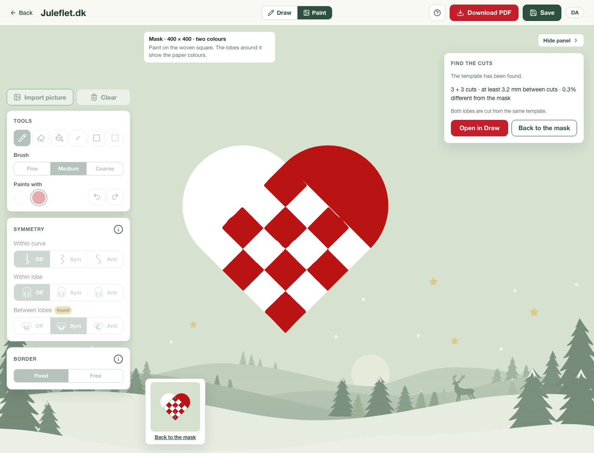

# Lobe-shape bias and end-to-end crop validation

The red/white locator assumed both lobes were semicircles. An unusually deep or
shallow lobe could therefore move an overlap corner while the model tried to
explain its outer outline. The adaptive and anchored palette routes already
allowed independent lobe depths; the original red/white route did not.

The locator now tries independent depths when a lobe is poorly explained by
the original fit. The lower edge lines and their tip intersection remain fixed.
The replacement must improve the same outline/colour objective, reduce the mean
of the two median lobe residuals by at least 30%, retain at least 65% outline
support on each lobe, and avoid materially worse paper-colour evidence. Normal
semicircles retain the original fast route. The proposal remains editable and
marked for review, with the previous and proposed corners recorded in its
`lobeRefinement` evidence.

This decision uses only image outline and colour evidence. Template agreement
never enters crop selection. Once accepted, the crop remains fixed through
classification, fitting, template checks and export.

## Why a low mask error can conceal a bad crop

Two generated checker photographs have known overlap corners and unequal lobe
depths. Their pixels alone enter detection and fitting. The exported curves are
rendered independently, then compared both with the classified crop and with the
known original four-by-four checker.

| Lobe depths | Corner error before → after | Cuts before → after | Classified-mask error before → after | Original-artwork error before → after |
| --- | ---: | --- | ---: | ---: |
| 0.40 / 0.70 | 16.19 → 1.49 px | 3 + 3 → 3 + 3 | 0.51% → 1.48% | 17.00% → 4.08% |
| 0.75 / 0.40 | 18.90 → 1.30 px | 3 + 4 → 3 + 3 | 0.65% → 0.37% | 21.51% → 4.08% |

The first case is deliberately retained even though its agreement with its own
classified mask gets worse. The original crop distorted the checker, and the
fitter accurately reproduced that distortion. The known-artwork comparison
shows the actual improvement. Remaining rasterization and corner uncertainty
prevent exact recovery; these are synthetic fixtures, not proof of photographic
corner accuracy or recovery of original cutting paths.

Regressions cover three unequal-depth pairs in both paper orientations,
exposure changes, half-size resampling, unchanged source pixels, and the ordinary
semicircle fast path. Two complete crop-to-export tests require three cuts per
sheet, the normal template checks, the unchanged accepted crop, and less than
5% disagreement with the known artwork.

## The red-tree photograph remains unresolved

The investigation began with the red/white Danish Things tree. Independent lobe
depths improve its outer-contour fit but still do not meet the existing reconstruction-quality
criteria. Stronger boundary weights,
balanced boundary rewards, extra shape starts and alternate palette proposals
were also inspected; none is promoted as a solution. Those experimental changes
are not in production.

The earlier manual crop gives a much better fit, but its corners are diagnostic
annotations, not surveyed ground truth. Each proposed crop changes the target;
lower disagreement alone cannot establish that it recovered the physical overlap.
The current change fixes a demonstrated model bias and improves the controlled
full-pipeline cases. It does not settle the tree's remaining crop and fitting
ambiguity.

## Automatic Hunodan validation

The existing speed benchmark uses frozen overlap coordinates. It is still useful
for fitting speed, but cannot detect a regression in automatic localization.
`web-photo-benchmark.mjs --corpus=hunodan` adds a separate automatic track for all
22 regular designs. It checks original image and decoded-pixel hashes, extracts
only each rough photograph rectangle, and discards the saved overlap quads.
Published template pixels and cutting paths never enter fitting.

`--locator-reference=<commit>` replays a detector copied from that commit into
an isolated temporary directory. The fitter and input photos remain current.
Reports retain both sets of source hashes. This permits before/after comparisons
without checking out, modifying or mixing another worktree's files.

## Measured validation

[The validation ledger](LOBE-SHAPES-VALIDATION.json) records source hashes,
reference-detector bytes, per-case corners, errors, timings and browser results.

Both automatic Hunodan tracks pass **22/22**. All 22 crop coordinates and
independent mask errors are exactly unchanged. The updated run takes **6.09 s
median, 9.02 s maximum**, including decoding, detection, preparation, fitting,
validation, artifact writes and independent rendering. The reference run takes
5.83 s median and 8.87 s maximum. These are serial single runs, not evidence of a
speedup; neither includes browser or worker startup. They are a distinct track
from the older frozen-corner speed benchmark.

The eight web-photo replays retain six passing candidates, one candidate needing
review, and one missing crop. Five passing errors are exactly unchanged. The
nested-heart candidate changes from **2.806875% to 2.84375%** with the same crop
and four cuts per sheet; the finite-budget run does not reproduce exactly. The
red tree's new target yields **6.71125%**, still unacceptable. Its earlier
**7.024375%** used a different crop, so the smaller number is not a directly
comparable reconstruction improvement. The angel still has no usable crop.

**20/20 production browser cases pass** across Chromium and WebKit: the unequal
lobes, preferred/independent/forced-symmetric/antisymmetric free-border hats,
the green-tree photograph, star, Hunodan photograph, and noisy checker/tree.
They check the actual worker, template geometry, paper checks, matching
preference, shared cuts, editable SVG conversion and PDF export. The known
checker has **1.30 px** maximum corner displacement, **3 + 3 cuts**, and **3.75%**
original-artwork disagreement in both browsers. Its classified-mask disagreement
is only **0.294%**. Conversion introduces no measured weave drift at 400 or 800
pixels. This distinction is intentional: passing the template checks does not
mean exact recovery of the source artwork.

The screenshot still shows small curved deviations and wedges near the cap.
Those remain visible limitations, even with correct cut counts and matching
sheets. Further fitting work should preserve the simple intended grid rather
than merely optimize agreement with these residual crop distortions.



The full suite passes **845 application tests** (one existing skip) and **532
inverse-engine tests**. Type checking reports zero errors and seven existing
warnings. Lint and production build pass. The preview's served crop and fitter
bytes match the tested source.

The subsequent [template cleanup study](CURVE-DEGREES.md) investigates the
remaining checker artifacts with fixed crop coordinates. It improves redundant
curvature selection while preserving the unresolved endpoint distortions as
separate evidence.

## Reproduction

```sh
node --test scripts/inverse/lobe-crop.test.mjs scripts/inverse/crop.test.mjs scripts/inverse/anchored-crop.test.mjs
node scripts/inverse/web-photo-benchmark.mjs --corpus=hunodan --stage=solve --seconds=10 --locator-reference=16908fa --output=tmp/lobe-hunodan-before
node scripts/inverse/web-photo-benchmark.mjs --corpus=hunodan --stage=solve --seconds=10 --output=tmp/lobe-hunodan-after
INVERSE_TEST_CASES=unequal-lobes INVERSE_TEST_BROWSERS=chromium,webkit node scripts/inverse/paint-browser-test.mjs
```

Run CPU benchmarks serially. Set `PLAYWRIGHT_MODULE` and `INVERSE_TEST_URL` for
the existing Playwright installation and local preview.
