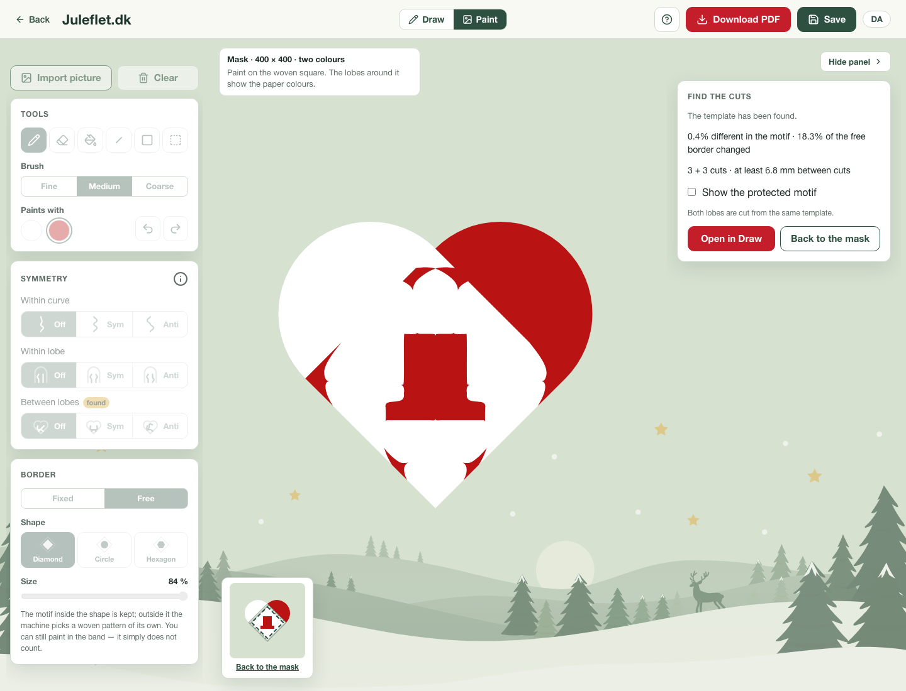

# Matching templates across import, fitting and export

Two separate restrictions prevented the soft matching preference from finding
available reusable templates.

The Paint page tied its advanced checkbox to the between-lobes symmetry row.
Photographs with no detected symmetry therefore disabled matching, and changing
or undoing that row overwrote an explicit checkbox choice. The preference now
starts enabled independently of the rows. Import, symmetry changes and undo/redo
preserve it; Reset enables it again. The checkbox and its accessible description
explain the one-percentage-point allowance in Danish and English. An explicit
opt-out still reaches the worker. The solver's existing rules for enforced
symmetry remain in force.

The first browser replay exposed a deeper search limitation. With no enforced
symmetry, the free-border hat uses two independent cuts per sheet and colour
phase 1. Copying either sheet gives more than 65% motif error. Refining those
copies cannot discover the known matching layout with three cuts per sheet and
phase 0. Enabling the preference alone was insufficient.

The matching search now reuses the equal-count grids and both colour phases that
the ordinary count initializer already computed. It projects each grid to
identical sheets, ranks the resulting image errors, and refines up to three
candidates together with the existing copy/average proposals. It uses the same
Bézier fitter and matching deadline; no second count search or fitted reference
template is supplied. Exact valid copy proposals are still checked first.

The original classified mask and free-border weights remain the reference.
Candidates must pass the original feature, geometry and paper checks and remain
within one percentage point of the repaired independent baseline. The existing
symmetry lower bound still skips matching when that allowance cannot suffice.
Shared-cut repair and simplification then run on the selected pair. Reports
record the independent cut counts and phase, the matching proposals, and the
selected cut counts.

The focused regression stores only the hat's imported mask and weights as short
run-length arrays. It starts a fresh solve, requires the change from two cuts to
three and from phase 1 to phase 0, independently renders the exported SVG curves,
and checks template identity, motif fidelity, the allowance, paper validity and
source immutability. The browser replay additionally checks preference defaults,
import, Reset, explicit opt-out, undo/redo, the real worker, editor conversion and
SVG/PDF downloads.

On the actual imported hat, the independent two-cut result has 0.296% motif
error. The new matching three-cut result has 0.410% error in the editable export,
adding 0.114 percentage points. It retains 228.09 mm of exactly shared cuts at a
100 mm overlap width, and those spans remain exact through editor conversion.
Click-to-editable time is 7.24 seconds in Chromium and 7.67 seconds in WebKit.
The displayed 0.4% describes the protected motif; the free border is allowed to
change and is reported separately.



All 22 regular Hunodan designs pass the existing quality and speed criteria,
with exactly unchanged independently rendered errors. Median preparation,
solving, validation and export time is 5.12 seconds; the maximum is 8.30 seconds.
The eight-photo replay also keeps every previous error and outcome: six pass,
the red tree needs review and the angel has no crop proposal.

All 845 application tests and 521 inverse-engine tests pass, with one existing
application-test skip. Type checking has zero errors and seven existing warnings;
lint and the production build pass. All 18 production-browser workflows pass in
Chromium and WebKit: preferred, independent, forced-matching and Anti hats, the
green-tree photo, the star, a Hunodan photo, and noisy checker/tree masks. The
green tree keeps independent sheets because matching exceeds the allowance.
The explicit opt-out, import, Reset, symmetry changes and undo/redo checks pass.
Firefox was not repeated after its previously recorded native launch failure.

[The validation ledger](MATCHING-SEEDS-VALIDATION.json) records the source hashes,
settings, timings, failed initial probe, comparisons and local artifacts.

The matching preference is a bounded search, not a proof that no other matching
solution exists when its candidates fail. The red-tree crop and missing angel
proposal documented in [the pipeline report](FULL-PIPELINE.md) remain separate
unresolved cases.

## Reproduction

```sh
node --test scripts/inverse/matching-seeds.test.mjs scripts/inverse/matching.test.mjs scripts/inverse/coarse-topology.test.mjs
INVERSE_SPEED_OUT=tmp/matching-seeds-hunodan node scripts/inverse/hunodan-speed-benchmark.mjs
INVERSE_TEST_CASES=top-hat-preferred,top-hat-independent,web-danish-tree-green INVERSE_TEST_BROWSERS=chromium,webkit node scripts/inverse/paint-browser-test.mjs
```

Configure `PLAYWRIGHT_MODULE` for the existing installation and
`INVERSE_TEST_URL` for the local preview. Run CPU benchmarks serially.
