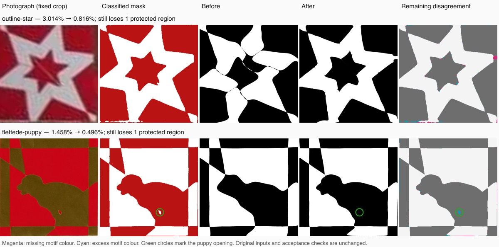

# Preserve useful curve fitting after speculative routing fails

The [31-heart full-pipeline comparison](HARD-CORPUS.md) identified a puppy whose
classified image preserves the opening between its legs but whose reconstructed
templates fill it. Fixing crop detection alone cannot address this failure.

## Two distinct problems

The automatic-crop run spent 6.61 seconds trying traced routings, including a
HiGHS timeout. By the time it reached free Bézier fitting, the refinement deadline
had expired. Its selected grid had only the initial `step: -1` checkpoint: no
free-curve updates at all. Independent exported-mask error was 1.458125%.

Reserving refinement time allows 750 updates on this same target and reduces
the first isolated replay's error to 0.49625%. No source pixels, probabilities,
crop corners, cut counts or final acceptance criteria changed. This is a
reconstruction improvement, not a new successful case: the opening is still
missing and correctly prevents a full pass.

The remaining opening also illustrates a limitation of the local gradient.
Its centre is approximately 8.6 mm from the closest fitted cut after refinement,
and the nearest cut in the other sheet is about 14.3 mm away. Boundary forces
evaluate the image along existing curves. A disconnected source region this far
away cannot attract them into a new route through ordinary local fitting alone.
This requires a different initialization or a coordinated change of routing.
The distances use the nominal 100 mm overlap, not a measured physical heart.

A separate diagnostic confirms this blind spot: filling only the 114 pixels of
that opening in a copy of the target changes **none** of the fitted candidate's
boundary-gradient coordinates. The maximum gradient difference is exactly zero.
The real source mask remains unchanged.

## Budget policy

When at least one fine-grid hypothesis already meets the ordinary image-error
target, feature recovery now reserves two seconds for free-curve refinement,
in addition to the existing clearance and polishing reserve. Tracing receives
the remaining available time, capped at its existing maximum. Its report records
`reserve_grid_refinement` so the allocation is inspectable.

When every fine grid exceeds the image-error target, the existing larger routing
budget remains available (`prioritize_routing`). Such grids may have the wrong
topology and cannot necessarily benefit from more local fitting.

A blanket reserve was tested and rejected: it prevented the existing group-tree
photograph from reaching its successful smoothed routing. The conditional policy
retains that regression test and the other photograph-recovery cases. The
separate slow-browser initialization and refinement-reserve tests remain intact.

## Further routing experiment

The existing coarse-topology fallback was tested separately on both fixed puppy
targets, without changing cropping or classification. The automatic target
produced a 52-segment, endpoint-compatible trace that preserved the opening, but
its routing solve timed out after five seconds. The historical target's proposals
failed opposite-edge count checks. Coarsening further removed the opening and
was rejected by the feature gate. Consequently, merely invoking that fallback
more often was not promoted as a solution.

## Corpus comparison

The fresh ten-second runs retain all previous passing cases. Source pixels,
effective crops, masks and probability fields are unchanged on both 31-heart
tracks; the 44-image run also retains the same crops and preparation metadata.

| Track | Previous passes | Current passes | Relevant result |
| --- | ---: | ---: | --- |
| 22 regular Hunodan designs | 22 | 22 | Every exported error is identical; maximum prepare/solve/validate/export time 8.411 s |
| 31 complete hearts, automatic crops | 11 | 11 | Puppy 1.458125% → 0.49625%; outline star 3.01375% → 0.81625% |
| 31 complete hearts, historical corners | 15 | 15 | No lost passes; puppy remains at 0.73625% |
| 44 separate web-photo selections | 11 | 11 | Still 18 requiring review and 15 without a crop |

All 59 generated hard-corpus pairs pass geometry checks. Guarded paper checks
pass for 28/28 automatic pairs and 27/31 historical pairs. This is a nominal
geometric check, not physical cutting or assembly validation. No new complete
hard-corpus pass is claimed: both highlighted improvements still lose a region.

Some already failing cases also change under the **unchanged** larger-routing
policy. The historical nested-squares result, for example, changes from 2.02625%
with uncertain paper support to 5.6525% with passing paper support. The selector
prefers the latter legal checkpoint. Single wall-clock-bounded runs can vary in
which checkpoints they reach; their full changes are retained rather than
attributed wholesale to this scheduling fix. The 22 regular-design errors and
all previously passing cases remain unchanged in outcome.



## Reproduction

The committed photograph and
[`photographic-puppy-fit.json`](../../scripts/inverse/fixtures/photographic-puppy-fit.json)
freeze the source hashes, crop, mask hash and probability hash. The regression
uses the production solver and independent exported renderer, verifies legal
geometry and paper support, requires a real refined checkpoint and an improved
mask fit, and retains any final missing-feature rejection.

```sh
node --test --test-concurrency=1 scripts/inverse/photographic-refinement-budget.test.mjs scripts/inverse/feature-refinement.test.mjs scripts/inverse/refinement-budget.test.mjs
```

The browser harness also accepts `hard-flettede-puppy` (and the other individual
`hard-<photo-case-id>` inputs). It uploads the committed photograph, uses the
production corner detector, then checks worker output, editable SVG download and
source-feature retention after conversion. These full browser uploads use the
app's ordinary settings; they are separate from the fixed-target ten-second test.

```sh
INVERSE_TEST_URL=http://127.0.0.1:5232 INVERSE_TEST_BROWSERS=chromium,webkit INVERSE_TEST_CASES=hard-flettede-puppy node scripts/inverse/paint-browser-test.mjs
```

Use `PLAYWRIGHT_MODULE` to select an existing external Playwright installation
when it is not installed in the project, as with the other browser checks.

## Browser findings and result notice

The first full browser pass checks eight uploads/drawings in Chromium and WebKit,
including the puppy photograph, followed by SVG download and independent editable
replay. All 16 workflow checks pass, as do all 59 saved hard-corpus conversions.
This does **not** mean all the motifs were recovered: both browser puppy results
still miss the opening, at about 0.47% editable-mask disagreement. With the app's
180-second allowance they try all 16 count/phase hypotheses and take about
62 seconds in Chromium and 72 seconds in WebKit. Extra search does not resolve
that routing failure.

The photograph-engine benchmark retains the classifier's continuous colour
probabilities. Mal imports the classified binary mask, then sends that editable
mask back to the worker; these are distinct fitting inputs even when their binary
targets match. Both browser puppy masks match the committed regression mask
byte for byte. Browser scores and times are reported separately from the
ten-second photograph-engine runs, rather than attributed to speed differences
alone.

Visual inspection found that the result panel discarded the engine's failed
feature-retention check. Because the puppy's average error is below the panel's
ordinary percentage-warning threshold, it showed no quality notice at all.
The page now retains that result flag and displays a separate Danish/English
message about missing motif details, even at low average error. The template
and download actions remain available. This notice reports the engine's feature
check; it does not change reconstruction or relax any acceptance criterion.

Component regressions cover both languages, errors above/below the percentage
threshold, older results without feature metadata and the enabled Open in Draw
action. A further browser replay checks the actual notice after worker completion.

## Final validation

All 851 application tests and 555 inverse tests pass, with one existing application
skip. Type checking reports zero errors and seven existing warnings; lint and
production build pass. The two additional real puppy uploads both display the
notice and still complete SVG download, with no feature loss introduced during
conversion. The checked page and engine hashes match the local production build.

The [complete validation ledger](REFINEMENT-SCHEDULING-VALIDATION.json) records
every corpus result, including degradations and unsuccessful reconstructions,
the gradient diagnostic, source hashes, 16 initial browser checks, two post-fix
notice checks and 59 editable SVG replays. Algorithm commit: `877c62e`. Notice
and browser-test commit: `fa49356`. No push or deployment was performed.
