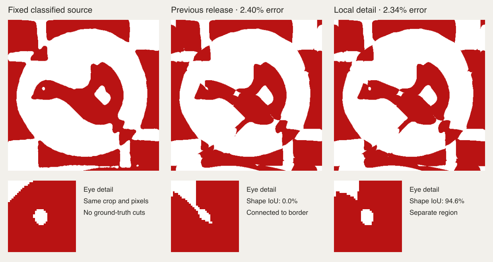

# Recovering the shape of small interior details



This follows [the bird routing and checkpoint fixes](BIRD-FEATURE-REFINEMENT.md).
The original photograph, automatic quadrilateral, classified pixels and inferred
5+5 routing stay fixed in the controlled experiments. No original cutting
template is available. The source is the committed
[bird fixture](../../scripts/inverse/fixtures/photographic-bird-fit.json).

## Diagnosis

The region-retention check can pass even when a thin unwanted seam connects the
bird's eye to the surrounding white background. Every source eye pixel can be
white while the reconstructed shape is wrong. This is a limitation of that
measurement, not evidence of a crop error.

The additional feature-preserving routing previously emphasized the interior of
each region. Its surrounding opposite colour retained the lower background
weight. This permits inflated shapes. Conversely, fitting the surroundings with
the existing long cubics alone does not consistently recover the intended shape.

The new diagnostic compares equally long continuations with and without exact
local subdivision. At a fixed 160 steps, using the same one-millimetre context
band, the unchanged graph returns a separate but distorted eye (about 65%
component IoU after finalization). The locally subdivided graph reaches about
95%, with lower whole-mask disagreement. Both pass the geometry and paper checks.

More subdivision is not uniformly better: one-millimetre segments without the
context band can reconnect the eye. Increasing the context band alone can also
stall. These rejected variants remain in the diagnostic results. Subdivision
changes regularizer sampling and normalization as well as degrees of freedom;
the measurements do not isolate those effects completely.

## Main-fitter change

After a feature-preserving routing has passed paper checks, the fitter can spend
up to 160 additional refinement steps on small interior details. This uses the
existing joint Bézier optimizer, without a separate user mode or a saved shape.

- Select substantial source regions with area at most four times the square of
  nominal paper width, wholly more than one nominal width from the crop edge.
- Split nearby curves by exact de Casteljau subdivision, down to the requested
  minimum paper width. Reuse each shared edge's subdivision in both sheets,
  including reversed occurrences. Abandon proposals needing 64 or more extra
  curves rather than growing the model without bound.
- Give the small regions and a surrounding band of half the minimum paper width
  the same weight. All tracked feature interiors keep their existing protection.
  Source colours and the crop remain unchanged.
- Keep the proposal only if it passes the existing geometry, paper and feature
  checks and does not increase original whole-image disagreement. The weighted
  optimization score cannot certify the output.

The step has a 1.8-second local allowance within the original solve deadline,
with a three-second finalization reserve. It replaces the optional unweighted
polish when accepted; final shared-cut and primitive cleanup still run. The
ordinary successful routing path does not request this additional work.

## Fixed-crop release comparison

Against the same 400-cell source, the previous released bird result had 2.4019%
mask disagreement and its eye component connected to the background. The new
result has 2.3388% disagreement and a separate eye with 94.64% component IoU.
The editable SVG replay has 2.4156% disagreement and 92.86% eye IoU, with both
geometry and paper checks passing.

| Independent rendering size | Previous error | New error | New eye IoU | Eye separate? |
| --- | ---: | ---: | ---: | --- |
| 400 × 400 | 2.4019% | 2.3388% | 94.64% | Yes |
| 800 × 800 | 2.5544% | 2.5175% | 89.04% | Yes |
| 1600 × 1600 | 2.5905% | 2.5495% | 87.30% | Yes |

Each row compares the same two exported geometries at matching resolution. The
larger targets repeat the original classified pixels; they add no photographic
information. Raster phase and antialiasing change the numerical scores, so
compare within a row. The previous result's eye is connected at all three sizes.

## Measurement limits

The new QA metric matches a source region to the predicted four-connected
component with greatest overlap, then reports intersection-over-union, area and
border contact. Unlike pixel retention, this exposes connecting seams and
inflation. It is a diagnostic, not a new global acceptance gate: raster
connectivity can be sensitive to diagonal contacts and photographic noise.

The independent renderer is also checked at twice the source resolution, using
nearest-neighbour copies of the same classified target. The regression requires
the eye to remain separate and exceed 80% component IoU after engine export.
Browser QA checks the actual downloaded, reparsed editable SVG against the same
shape criterion. Graceful Stop can return an earlier valid checkpoint and is
therefore not required to have completed this optional shape refinement.

Thin seams elsewhere on the bird remain. The change improves a measured small
feature; it does not establish recovery of unknown original templates or
physical assembly quality.

## Reproduction

```sh
node scripts/inverse/feature-detail-study.mjs --halos=4 --steps=160 --halos-only=1 --finalize=1 --output=tmp/detail-study
node --test scripts/inverse/feature-details.test.mjs
node --test --test-name-pattern='full fitter retains the bird' scripts/inverse/feature-seeds.test.mjs
node scripts/inverse/hard-photo-benchmark.mjs --ids=bird --seconds=25 --target=mask --output=tmp/detail-bird
node scripts/inverse/hard-photo-editor-replay.mjs --run=tmp/detail-bird --output=tmp/detail-editor
```

The study starts from fresh image-derived grids. Its fixed-step experiments have
no production time limit; their scores must be distinguished from the timed
end-to-end benchmark. Each run records source hashes and keeps the original
mask and probability hashes inspectable.

## Release QA

[Machine-readable evidence](SMALL-FEATURE-VALIDATION.json) records paired results,
source hashes, renderer resolutions and browser timings. Production code is
`aef8405`; later commits add QA and this report.

- **22/22 regular Hunodan designs** pass with exactly unchanged errors. The
  slowest preparation + solve + validation + export is **8.29 s**. None needs
  the new detail step. Decode and independent rendering are timed separately.
- The complete ten-second photographic run retains **16/31**, with all previous
  successes preserved. Three cases have no crop proposal. All 28 produced pairs
  pass engine and editable-SVG geometry/paper checks. Among the 12 image
  failures, nine exceed the mask-error threshold and seven lose a tracked
  region; four have both problems. These are failure categories, not proof
  that every remaining cause has been isolated.
- The selected eight-case run with a 25-second search allowance retains **6/8**.
  All eight pairs survive editable conversion and physical checks; the same six
  pass image fidelity afterward. The bird improves to **2.3388%** independent
  disagreement in **22.65 s** including preparation and validation. Outline-star
  and crossed-ribbons still carry missing-region warnings. These warnings are
  not counted as successes despite their lower overall errors.
- **Eight browser cases pass:** Chromium and WebKit × bird mask, original puppy
  photograph with automatic cropping, star example and free-border top hat.
  The actual downloaded SVGs pass editable geometry, paper and image checks.
  The star and bird PDF downloads are checked as well. The hat retains its long
  exact shared cuts.
- In Chromium/WebKit respectively, the bird's editable error is **2.4531% /
  2.4588%**, eye component IoU **91.07% / 89.29%**, and click-to-ready time
  **24.42 / 26.53 s**. The app uses its normal longer maximum budget, so these
  browser times are distinct from the 25-second engine experiment above.
- **Two additional Stop tests pass**, interrupting the real worker during the
  new detail-polishing stage. Finalization completes in **6.63 / 6.30 s** and
  rechecks the retained geometry at paper resolution 700 before editable export.
  The QA proxy introduces the pause; it supplies no seed or cutting geometry.
- `npm test`: **854 application tests pass, one existing skip; 569 inverse tests
  pass**. `npm run check`: no errors, seven existing warnings. Lint and production
  build pass. Served fitter hashes match the checked source.

Crop coordinates, classified masks and fitting-probability hashes are identical
in the paired photo sweeps. Small changes in a few unchanged fitting paths are
consistent with their time-bounded refinement; they are not attributed to the
new local-detail method.
