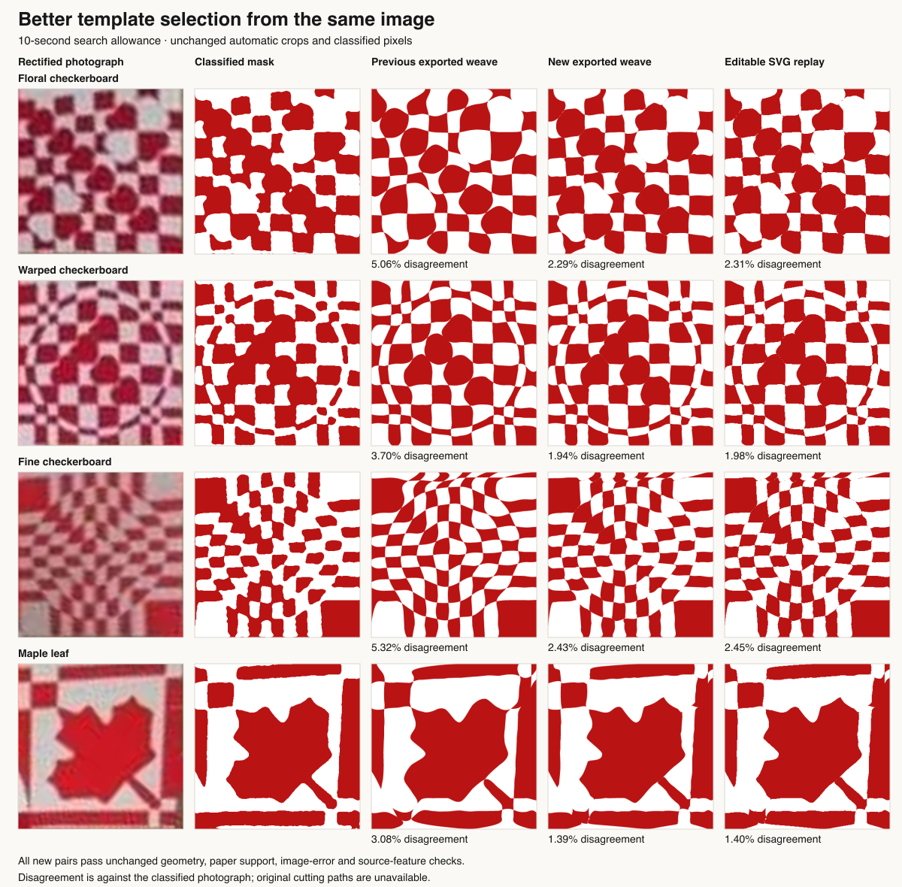

# Better image fits hidden by coarse paper uncertainty

Three dense photographic motifs remained above the 3% image-error threshold:
the floral checkerboard, warped checkerboard and fine checkerboard. Extending
the original search to 25 seconds still returned errors of 4.61%, 3.72% and
5.40%. Their crop coordinates and classified images remained fixed throughout
this investigation.

## Root cause

The optimizer reached better, geometry-valid shapes. The 360-cell guarded paper
lattice called those checkpoints **uncertain**, so refinement rolled back to a
previous paper-passing point. Repeating that search did not resolve uncertainty.
The final selector preferred the older paper-passing result, even when its image
was too inaccurate to accept.

The earlier checkpoint fix retained an uncertain result when no paper-passing
result existed. This case is different: a passing incumbent exists, but its
image fit is substantially worse. The better uncertain result was retained
internally, then discarded at the return boundary.

In fixed-step continuations of the old image-derived candidates, independently
auditing the **same uncertain coordinates** at 700 cells passes all three:

| Motif | Old candidate | Better retained checkpoint | Fine paper audit |
| --- | ---: | ---: | --- |
| Floral checkerboard | 4.6119% | 2.7319% | Pass |
| Warped checkerboard | 3.7200% | 2.4088% | Pass |
| Fine checkerboard | 5.4044% | 2.9700% | Pass |

Those percentages come from the separate exported-SVG renderer. The fixed-step
experiment is diagnostic; it is not a production solve-time result. It changes
neither the crop, slit counts, geometry nor source mask between the coarse and
fine audits. This isolates a checkpoint-selection problem. It does not prove
that the photograph's crop or inferred artwork is exact.

## Production fix

`refineCurves()` still returns its verified incumbent by default. It also exposes
the best geometry-valid, paper-uncertain alternative. That alternative is not
certified and never becomes a rollback position during the coarse search.

When the incumbent fails source-image acceptance, the main fitter checks the
alternative against the original pixels and every tracked source feature. Only
an otherwise acceptable alternative earns the existing finer paper audit,
within the original time budget. A successful fresh audit adds a candidate; it
does not overwrite the incumbent or remove the previous routing-search allowance.
This matters because later routings can be better still, as the maple-leaf
diagnostic demonstrates.

The verified resolution accompanies progress checkpoints and the selected
pair. Stop, final cleanup and export recheck the actual retained geometry at
that resolution. The physical constraints, 3% image threshold, substantial
feature checks and source pixels are unchanged.

The deterministic regression in
[`refinement-checkpoints.test.mjs`](../../scripts/inverse/refinement-checkpoints.test.mjs)
starts from the old fitter's floral-checker candidate and demonstrates the
360-uncertain/700-pass result on identical coordinates. A separate fresh-fit
test supplies only photograph pixels and the frozen crop, then checks independent
export and the newly verified Stop packet. Saved fixture curves never enter
that end-to-end solve or the application.

## Further fitting experiments

The original hypothesis was insufficient curve detail. Continuing with the same
curves at paper resolution 700 reaches 1.36%, 1.42% and 1.81% error; splitting
long cubics before that continuation reaches 0.85%, 0.65% and 0.74%. Those runs
use 600 extra steps with no production deadline and are **not shipped** as a new
fitting stage.

Changing the paper resolution for a whole refinement also changes its guarded
clearance margin. Subdivision changes regularizer sampling and normalization.
Those results therefore do not isolate degrees of freedom alone. Exact split
geometry can also produce slightly different antialiased raster decisions;
the diagnostic records that drift separately from the final image error.

The independent finer audit of unchanged checkpoints above is the evidence for
the shipped fix. Additional curve refinement remains a measured opportunity.

## Reproduction

```sh
node --test scripts/inverse/refinement-checkpoints.test.mjs
node scripts/inverse/hard-photo-benchmark.mjs --ids=floral-checker,warped-checker,fine-checker --seconds=10 --target=mask --output=tmp/checker-replay
node scripts/inverse/hard-photo-editor-replay.mjs --run=tmp/checker-replay --output=tmp/checker-editable
```

`dense-refinement-study.mjs` accepts a saved benchmark directory via `--run`,
an output directory via `--output`, and an optional `--steps` count. The recorded
study starts from the unmodified `0ca34af` fitter's 25-second outputs. It records
the source mask, geometry and runtime-source hashes for each comparison. Its
default benchmark inputs are local diagnostic artifacts, not ground-truth cuts.

## Production dataset results

The complete automatic-crop, import-to-mask run improves from **16/31 to 20/31**
accepted complete photographs with a 10-second fitting allowance. Every previous
success remains accepted. The four new successes are the floral, warped and fine
checkerboards and the maple leaf. All crop coordinates, classified-mask hashes
and fitting-input hashes are identical to the previous run. The other 16 inventory
entries are incomplete or obscured and remain explicitly excluded; three complete
photos still have no crop and remain failures in the denominator.



A longer-budget diagnostic set improves from **8/13 to 11/13** at 25 seconds,
retaining all eight previous successes. The maple leaf keeps its better later
three-cut routing, and the bird keeps its separate eye. One Viking result changes
by one pixel (2.271875% to 2.2725%); this is a time-bounded run, so its accepted
result is not described as a quality improvement.

All **22 regular Hunodan photographs** still pass, with exactly unchanged image
errors. The slowest preparation + solve + validation + export is **8.281 seconds**.
This excludes photograph decoding and the independent external renderer.

The hard-photo 10-second allowance is a search budget, not a click-to-ready
promise. The four new successes take 9.40–9.59 seconds for solve and validation;
including crop detection, preparation and independent replay, their recorded
benchmark totals are 10.56–11.37 seconds. The 25-second continuation cap described
below does not change the search deadlines for either dataset run.

Editable conversion and SVG serialization/parsing pass for all **28 produced
10-second pairs** and all **13 longer-budget pairs**. Every one passes the editor's
intersection rules and the geometry/paper re-audit. Complete image/feature
acceptance remains 20 and 11, respectively; conversion does not promote an
inaccurate or feature-losing fit to a successful reconstruction.

## Browser continuation and remaining limitations

Browser QA with the normal 180-second maximum exposed unnecessary continued
routing search after a finer-verified alternative was already acceptable. The
first Chromium run took 37.7, 53.5 and 41.2 seconds click-to-ready for the three
checkerboards, despite passing export and image checks. That run was interrupted
after its five Chromium cases; it is retained as a timing diagnosis, not a
completed browser release check.

After a retained alternative passes all checks, additional routing comparisons
now use at most the established 25-second search allowance. This preserves the
useful later routings measured by the 25-second dataset run. It does not stop
search early when no acceptable alternative exists, and final validation still
runs. If the first acceptable alternative only arrives after 25 seconds, this
cap cannot recover elapsed time; it stops further portfolio expansion.

The remaining ten-second failures split across the pipeline: three missing crops,
several fits that need longer routing/feature search, and small source regions
near the crop boundary that remain unrepresented even at 25 seconds. The outlined
star and crossed ribbons each miss a small light region near the bottom edge.
Their low total error does not exempt them from the feature check. Whether these
particular regions are intended design, crop error or photographic artifacts
needs separate evidence; this change does not relabel or erase them.

These scores measure agreement with classified photographs, not unavailable
original artwork or cutting templates. Paper checks are nominal geometric tests;
the resulting hearts have not been physically cut and assembled.
