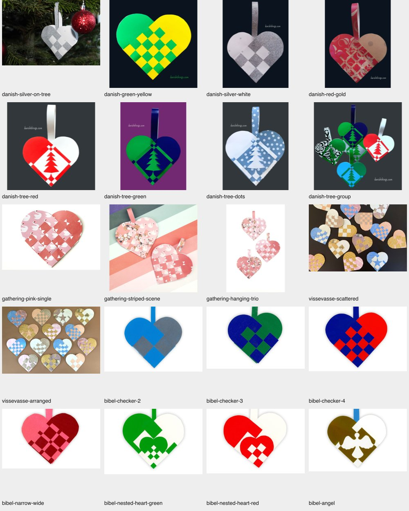

# Expanded real-photograph dataset

Added 20 source photographs and 44 selected heart instances from Bibelselskabet, Danish Things, Gathering Beauty and ViSSEVASSE. All retain original bytes, attribution, URLs, checksums and published-template links. Related photographs are grouped by family. These are not 44 independent designs.



[Dataset and commands](../../scripts/inverse/fixtures/web-photos/README.md) · [Machine-readable baseline](WEB-PHOTOS-BASELINE.json)

## Baseline full pipeline replay, 2026-10-11

A fresh run uses the current automatic locator, colour conversion, cut-count
search, common fitter, template checks and independent export renderer. All 44
cases remain in the denominator. Inputs are original source pixels and rough
selection rectangles; no corrected corners or published cuts initialize fitting.
The ten-second budget applies to fitting, not the entire photo-to-report process.

| Existing dataset track | Cases | Candidate checks pass | Needs review | No crop |
| --- | ---: | ---: | ---: | ---: |
| Two-colour | 12 | 7 | 3 | 2 |
| Printed paper | 28 | 2 | 16 | 10 |
| Scene | 4 | 0 | 1 | 3 |
| Total | 44 | 9 | 20 | 15 |

All 29 generated pairs pass the nominal geometry and guarded paper checks.
Of the 20 needing review, 19 exceed 3% independent mask disagreement and 15
lose protected source regions; these categories overlap. Proposal presence and
passing checks are not surveyed corner accuracy, physical assembly tests or
recovery of published cutting paths. The two-colour track includes textured
silver paper and subtle printed dots, so it is not a uniform-material guarantee.

Visual inspection identifies different upstream causes:

- **Silver heart on the tree:** the overlap proposal includes part of the lobe
  and surroundings. Classification also fragments the glitter. The solver returns
  1+1 cuts and 3.775% disagreement; neither its mask nor crop describes the intended
  checker reliably.
- **Silver/white checker:** its crop is plausible and the solver selects the
  plausible 2+2 counts, but glitter and printed-paper variation become false
  holes in the mask. The reconstruction remains at 5.51625% disagreement.
- **Dotted tree:** paper decorations become apparent motif holes before fitting.
  The resulting 13.11% disagreement is not explained by solver runtime alone.
- **Blue/green 3×3 checker:** this baseline passes at 1.4875%, but uses 3+3 cuts.
  Top and left inset profiles consistently report two transitions; the other
  sides are inconsistent. A subsequent [cut-count investigation](COUNT-FINALISTS.md)
  confirms premature search termination: a 2+2 finalist was initialized but
  never given curve refinement. The common fitter now refines it despite the
  conflicting border evidence and obtains a valid 2+2 pair at 1.4375% on the
  unchanged crop and mask. Bowed edge regions still remain.
- **Printed green checkers:** two pass the numerical checks while retaining some
  printed details as geometric defects. A low mask error does not mean the
  underlying weave has been recovered correctly.

The green nested-heart and angel photographs still have no usable proposal.
The red/white tree is at 6.71125% in this baseline. A subsequent
[routing-retention fix](PROVISIONAL-ROUTING.md) reduces it to 2.05375% on the same
crop and mask by refining a previously discarded MILP candidate. That release
still needed review because of a classified fragment near the edge, and the
browser spent too long trying other layouts. The follow-up below addresses
that specific source of instability; these historical failures remain recorded.

[Current measurements and source hashes](CURVE-DEGREES-VALIDATION.json) include
all 44 outcomes. Full visual panels and exported candidates are generated at
`tmp/adaptive-primitives-web-all/report.html`. The fresh all-case run is a new
baseline for further pipeline work; it does not isolate the effect of one recent
code change. The narrower [curve cleanup study](CURVE-DEGREES.md) has a separate
fixed-output experiment for that purpose.

A subsequent [cut-count refinement replay](COUNT-FINALISTS.md) retains the same
9/20/15 outcomes and all automatic crops across the 44 cases, while reducing the
blue/green checker's cuts from 3+3 to 2+2 and its independent error to 1.4375%.
Its [measurement ledger](COUNT-FINALISTS-VALIDATION.json) keeps before/after values
for every case, including the failures. This is improved template selection
inside the full pipeline, not an increase in the number of passing photographs.

The latest [border-feature and routing-trigger replay](PROVISIONAL-ROUTING.md#follow-up-stable-interior-features-and-an-independent-routing-trigger)
has **10 passes, 19 needing review and 15 without a crop**, with all 44 source
photos, automatic crops and preparation metadata unchanged. The two-colour
track changes to 8/2/2; other tracks retain their previous outcomes. The extra
pass is the red tree under an explicit revised policy: a component separated
from the square edge by only one source pixel no longer receives the extra
interior-feature retention check. Every observed pixel remains in image error,
and geometry, paper and image-error limits are unchanged. It does not mean the
edge fragment was reconstructed. Useful routing can now also be triggered by
poor grid agreement even when the component-retention audit passes.

The tree's error remains 2.05375%; browser completion falls from 72–76 seconds
to 4.56–4.60 seconds with unchanged editable error. Overall, 28 of 29 exported
errors are exactly unchanged; `vissevasse-arranged-r2c1` increases by three
pixels (0.001875 percentage points) and still needs review. All 29 generated
pairs retain valid geometry and guarded paper checks. The
[complete follow-up ledger](BORDER-FEATURE-VALIDATION.json) includes these
limitations alongside the 22 regular Hunodan speed checks and 12 browser runs.

The subsequent [closed-contour and tracing-seed correction](JUNCTION-RECOVERY.md)
raises the full-photo result to **11 passes, 18 needing review and 15 without a
crop**, with unchanged sources, crops and preparation metadata. The right-hand
tree in the group photograph improves from 5.973125% to 1.9225% exported error
and from 4+4 to 3+3 cuts. This additional pass comes from a better reconstruction
under unchanged acceptance criteria. The green tree also improves from 1.1375%
to 1.075%. All 29 generated pairs retain valid geometry and guarded paper checks;
the [complete ledger](JUNCTION-RECOVERY-VALIDATION.json) preserves two smaller
time-budget variations in printed-paper cases, including one error increase.

The new browser test exposes a separate unresolved crop variant: uploading
only the rough-ROI portion of that group photograph produces different corners,
1-versus-3 edge counts, and a poor 1+1 fit after 75–81 s. Both browser failures
and their exact source mask are retained. The successful full-photo case does
not establish success for that cropped upload. All 12 previously established
browser checks and the 22 regular Hunodan speed/quality checks still pass.

```sh
node scripts/inverse/web-photo-benchmark.mjs --stage=solve --seconds=10 --output=tmp/adaptive-primitives-web-all
```

## First pass, 2026-09-08

The Node benchmark uses the same detector, preparation and automatic solver modules as the site. It receives only source pixels and the pre-annotated rough rectangle for group photos. This run does not replace browser QA. No detector, classifier or fitter was tuned on these new cases before recording the results.

- 29/44 selections produced a crop proposal and prepared mask.
- 15/44 produced no crop. These remain in the denominator and report.
- All 29 proposals were marked for review by the detector. Proposal presence is not a crop-accuracy score.

Visual inspection exposed distinct problems:

1. **Cropping:** the silver heart hanging on a tree includes lobe/background pixels in its proposed overlap square.
2. **Colour conversion:** the blue/green 3x3 checker photograph becomes mostly vertical bands. This loses genuine cells before the fitter runs.
3. **Printed paper:** stripes, dots, swans and flowers on the paper become false weave boundaries. These inputs violate the uniform two-colour assumption even when their crop is plausible.
4. **Glitter:** a plausible silver/white crop still contains many false tiny holes from highlights and texture.

These observations are recorded separately from fitting errors. Template links are retained, but the new published cuts have not been digitized or independently audited.

## Solver integration smoke check

Three predetermined examples were run with a ten-second solver budget, followed by an independent resvg rendering of the exported cubic paths. Total times include decoding, detection, preparation, fitting, validation and exporting.

| Photograph | Total time | Estimated-mask disagreement | Candidate checks |
| --- | ---: | ---: | --- |
| Red/white tree | 11.58 s | 7.02% | Needs review |
| Blue/green 3x3 checker | 8.11 s | 1.70% | Passed, but classified input is visibly wrong |
| Red/white nested heart | 11.24 s | 2.94% | Passed |

The checker example demonstrates why candidate checks cannot substitute for visual or published-template evaluation. All three runs checked exported geometry; the numerical scores compare with the estimated image mask, not the original cutting paths. Border/unknown pixels are excluded from error only when the source validity mask says they are unobserved.

Full initial visual reports are generated locally at `tmp/inverse-web-photos/initial-prepare/report.html` and `tmp/inverse-web-photos/solve-smoke/report.html`. Rerun with the documented commands to recreate them; source inputs are committed and the benchmark requires no network.
