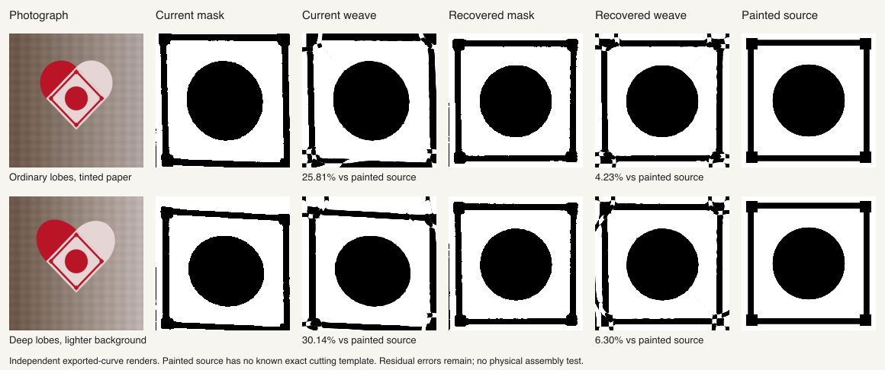

# Framed-pattern crop recovery

The experimental crop fallback substantially improves two photographed frame
fixtures through the full reconstruction pipeline. It is **integrated in source,
with release QA pending**. The public preview runtime remains `3865cf1`; the branch was
pushed through documentation commit `e1e6959` before these experiments.

The current crop's fitting score can hide a large registration error: the fitter
accurately reproduces the wrong rectified target. These two ten-second requests
both returned templates passing geometry, paper and independent raster-feature
checks, despite very different fidelity to the original painted artwork.

| Photograph | Crop | Maximum corner error | Import versus artwork | Export versus import | Export versus artwork |
|---|---|---:|---:|---:|---:|
| Ordinary lobes, tinted paper | Current | 8.812 px | 25.841% | 2.814% | 25.808% |
| Ordinary lobes, tinted paper | Recovered | 1.029 px | 2.653% | 2.202% | 4.232% |
| Deep lobes, lighter background | Current | 11.829 px | 29.761% | 1.727% | 30.140% |
| Deep lobes, lighter background | Recovered | 1.341 px | 4.537% | 2.583% | 6.304% |

The corrected templates still have visible corner seams and protrusions. These
are painted crop controls, **without known exact cutting templates**. Their
rendered source artwork is used only for evaluation after fitting. The automatic
detector receives a photograph and rough selection; the fitter receives only
the classified crop, with no supplied counts or saved templates. No crop is
chosen by how easily its target can be fitted.

Crop detection took 2.21–2.40 seconds with recovery. Fitting and its final checks
took 10.23–10.30 seconds, despite the ten-second search setting; import and the
independent exported-curve render are additional. These are single development
runs, not latency guarantees. The baseline and alternative run in opposite
orders between the two photographs.

## Why the detector accepts the wrong boundary

The existing lower-edge support measures line-fitting inliers after sample
positions have been adjusted using colour gradients. An interior motif line
can therefore have good reported support while being far from the physical
paper boundary. The upper-boundary contrast reward can reinforce that mistake.

A separate diagnostic holds each proposed quadrilateral fixed and checks both
lobes and both lower sides against observed paper fields. Only cap depths can
move. In the four failing framed controls, the old line supports are about
0.67–0.85, but independently sampled physical lower-edge supports are 0–0.056.
The alternative crops have physical lower-edge supports of 0.889–1.0.

The fallback is conditional:

1. Start with the current supported, fully in-photo crop using the varying-
   background palette model and actual colour evidence.
2. Keep it if the independent physical-outline check passes.
3. Otherwise propose a crop using robust paper-colour medians, constrained
   three-colour foreground mixtures, no upper-diameter contrast reward, and
   lower lines fitted from segmentation without the colour-gradient adjustment.
4. Accept only a supported, fully in-photo proposal that passes the physical
   outline check on the **unchanged original fields**.

Checking both proposals against the same fields avoids selecting a hypothesis
merely because it changes its own segmentation. The earlier unconditional
colour/objective replacement regressed checker and shadow controls and remains
rejected. Known corners never enter the selection rule.

## Regression evidence

The frozen 89-input crop replay changes only the four intended framed controls:

| Case | Current corner error | Recovered corner error |
|---|---:|---:|
| 02, ordinary tinted | 8.812 px | 1.029 px |
| 08, ordinary lighter background | 8.938 px | 1.601 px |
| 10, deeper tinted | 11.063 px | 1.791 px |
| 12, deeper lighter background | 11.829 px | 1.341 px |

The other 85 crops are unchanged, including all 40 real collage instances and
six shadow/exposure controls. No unsupported crop is promoted by this replay.

A separate full-pipeline diagnostic renders **14 photographs from validated
cutting geometry**: two procedural shared frames and twelve nested frames,
covering three outer slit positions, two lobe depths and both colour phases.
The source witnesses pass geometry, paper and independent-render checks before
photograph generation. This is development evidence, not a held-out model score;
no dataset splits or neural training were changed.

The fallback does not activate on these 14 photographs. All paired crops and
imported masks are identical. Thirteen pairs also export byte-identical cutting
geometry. One pair differs during time-limited fitting despite identical inputs;
that is not a crop-recovery effect. All **28 fits** pass the production geometry
and paper checks. The independent raster feature audit passes **26**, with the
same enclosure discrepancy in both runs of one case, discussed below.

Known-design error ranges from 1.08% to 3.56%, even though fitting error against
the imported mask is only 0.19%–1.01%. Correct import geometry and photographic
colour conversion therefore remain relevant after a numerically good fit.
These runs exercise the engine's photo-to-mask-to-template route. Paint's
enlargement, automatic symmetry and editable-curve conversion need separate
browser checks before integration.

## A raster enclosure discrepancy

In the inverse-colour, ordinary-lobe nested frame with outer slits at 10 mm,
the native 320-pixel renderer preserves all four small enclosed regions. The
independent SVG render at the same resolution reports one region connected to
the square boundary. Both outcomes were preserved rather than overriding the
failed independent check.

Replaying the **same fixed curves**, without fitting again, shows sensitivity
to raster resolution and threshold. The independent 50% coverage mask fails
at 320 pixels but passes at 640 and 1280. Native point sampling passes at 320
and 640 but fails at 1280. The exact source witness passes all these checks.

A separate polygon check adaptively flattens the exported cubics and forms
even-odd colour regions with Clipper2. At tolerances of 0.01, 0.001 and 0.0001 mm,
all four queried source-region centres belong to enclosed components, well away
from the square boundary. The disputed component has area 24.818–24.828 mm².
This is stable finite-precision geometric evidence, not an exact algebraic
certificate; it does not prove every part of a complex source component is
preserved merely because its centre is enclosed.

The raster failure is not sufficient evidence of a real opening here. It also
shows why one raster resolution should not settle an enclosure dispute. No
production feature-protection rule was weakened or changed in this experiment.

## Remaining integration work

The source implementation reuses the working photograph and original registration
fields. A robust colour-mixture model is prepared only after the original
physical-outline audit fails. Both proposals are checked against the unchanged
original fields, and the existing support and in-photo requirements still apply.
It starts from the user's rough rectangle; a tighter component box is estimated
only when the new model's first attempt lacks support. An inferred component box
from the previous segmentation is not carried forward as an input constraint.

Eighteen focused tests initially passed. The first frozen-output replay then
found a 0.237-pixel difference on the deep tinted frame because of that inherited
component-box policy. The corrected implementation passes all seven new focused
tests. The first replay and its failure are preserved. The corrected replay
matches **all 103 quadrilaterals byte for byte**, including all four recovered
frames. Typecheck, lint, build and **874 application tests** pass, with one
existing application skip.

Both actual browser upload/selection/solve/editable-export workflows also pass:

| Case | Corner error | Editable error versus import | Editable error versus artwork | Click to ready |
|---|---:|---:|---:|---:|
| Ordinary tinted frame | 1.029 px | 2.298% | 4.279% | 16.21 s |
| Deep lighter-background frame | 1.996 px | 2.972% | 7.200% | 14.35 s |

The pointer-generated selection is
`[84.99998881554728, 40, 299.9999712399787, 250]`. Both workflows pass the exact
native 320-pixel import to the solver without an automatic symmetry edit. The
downloaded SVGs pass independent editable geometry and paper checks, with six
cuts per sheet. These use the application's 180-second maximum request, not
the offline ten-second request; the single timings are not speed-comparison
measurements.

Both result screenshots were inspected. Corner protrusions and thin seams
remain. The deep-frame crop differs from its integer-selection counterpart,
whose corner error was 1.341 pixels; small pointer-coordinate sensitivity is a
remaining issue. No artwork or solver score selected either crop.

The complete inverse suite is currently running. Its final result and a preview
refresh are still pending. Source hashes are pinned for that run. Exact release
measurements and artifact hashes are in
[framed-outline-integration.json](framed-outline-integration.json).

Investigate renderer-dependent enclosure diagnostics separately. Physical
cutting, threading and assembly remain untested.

Exact measurements, input and artifact hashes, the retained raster failures,
and polygon results are in [framed-outline-recovery.json](framed-outline-recovery.json).
Local diagnostic code and raw artifacts remain under
`tmp/heart-learning/bauble-segmentation-2026-10-18/frame-edge-study/`.
