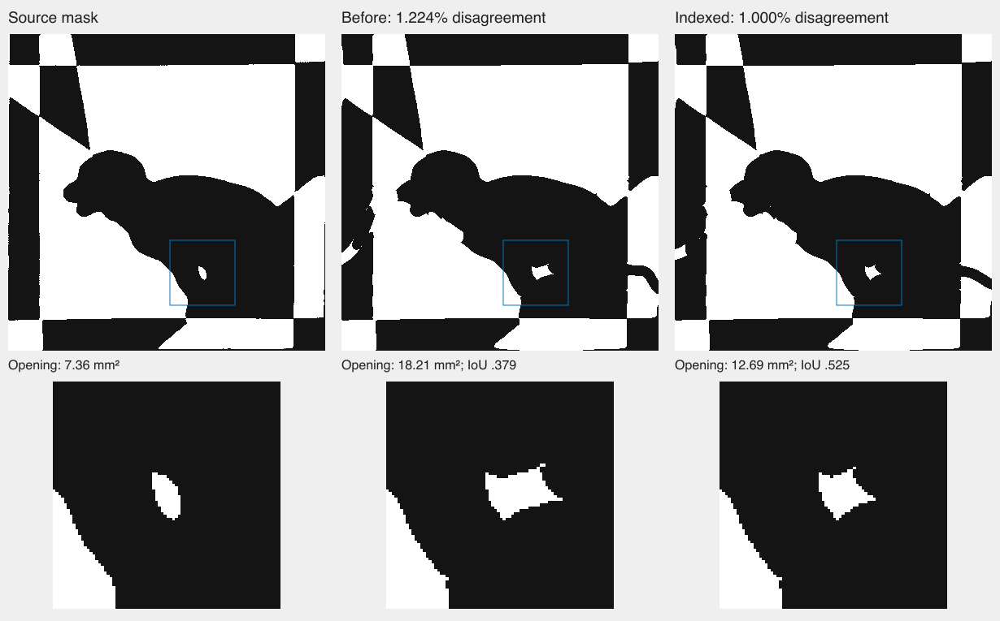

# Indexing scalar image loss without changing its values

The common Bézier fitter built a spatial row index, then ignored it when
integrating image loss: every integration row scanned every sampled segment.
It now uses that index in the ordinary orientation and builds corresponding
bins for transposed integration. Segment order, direction, crossing arithmetic,
image integrals, shared-cut multiplicity and pixel conventions stay unchanged.
The gradient, objective, iteration caps and acceptance limits are unchanged.

A frozen full-scan reference checks the optimization independently of its row
selection. The regression covers empty and dense grids, shared cuts, horizontal
segments, bin boundaries, backward-running curves, out-of-square controls,
disconnected joins, perturbed controls, both phases and weighted observations.
Every compared scalar is exactly equal, including the one-call API.

The [recorded study](indexed-boundary-loss.json) uses 40 combinations of fixed
geometry, image resolution and weights, with four alternating timing orders.
Both implementations prepare image integrals once. The committed reproducer
measures a **47% median reduction in evaluation time**; dense-grid reductions
are **77–79%**. An earlier isolated prototype measured 57% at the median. The
four empty-geometry cases are slightly slower; all cases remain in the report.
These are component measurements, not whole-solver or browser speed claims.

```sh
nice -n 15 node scripts/inverse/diagnostics/boundary-row-index-study.mjs \
  --output=tmp/boundary-row-index-study
```

The output directory must be new. The script records source hashes, individual
timing batches and exact-agreement checks. Saved curves are evaluation inputs;
they never initialize the fresh-fit tests.

All nine failures from the preceding complete suite pass in one serial replay
after this change, with unchanged tests and source masks. The dense checker
has 2.670625% engine disagreement, versus 4.32125% in the failed full run. The
half-resolution puppy's independently rendered exports show:

| Fresh-process output | Error at 390 px | Opening overlap | Error at 780 px |
| --- | ---: | ---: | ---: |
| Before indexing | 1.2235% | 37.94% | 1.3309% |
| Indexed loss | 1.0000% | 52.50% | 1.1315% |

Both outputs pass geometry and paper checks, but the earlier opening is too
large for the existing shape regression. The new output retains an enclosed
opening and passes that unchanged threshold. Its shape remains imperfect:
overlap is only slightly above the required 50%. The doubled-resolution
measurements supplement the original 390-pixel test.

These fresh fits are timed runs, not a counterbalanced attribution of all nine
recoveries to indexing. In particular, the three original sloth failures spent
their recovery allowances in HiGHS without a rejected candidate to refine;
their MILP recovery cannot simply be credited to a faster continuous loss.

Seven scalar/native checks, 21 weighted checks, the nine captured replays,
type checking, lint, the build, and 874 application tests pass (one existing
skip). All 1,041 pinned sources match after standard QA. The standalone
benchmark was then added, executed and linted. The subsequent complete inverse
suite finished with **1,060 passed and one failed** in 1,370 seconds, with all
1,042 pinned sources unchanged. All nine earlier failures passed. Browser
comparisons have not started; the preview remains on its prior validated
snapshot.

## Visual inspection: a passing small-feature test is still imperfect



Independent rendering of the saved outputs confirms a remaining local defect:
the source oval becomes a pointed opening. Its area improves from 18.21 mm² to
12.69 mm², but the source is only 7.36 mm². The 52.5% overlap passes the existing
regression without establishing a faithful reconstruction. These are the same
captured runs in the table above, not additional fresh solves.

The recorded detail pass did **not** produce the selected improvement. It ran
105 steps and returned a geometry/paper-valid candidate, but was rejected:
original-image disagreement rose from 1.0158% to 1.1729%. Its four rejected
checkpoints all report the same tight return on sheet 0, slit 1, curves 15–16.
Those witness points are 35.7–36.7 mm from the small opening, not on its edge.

`featureDetailPlan` adds curve segments near the feature but leaves distant
controls free. The same common fitter already has a spatially scoped polish
plan, currently used only after fitted-boundary rerouting. The next experiment
will compare scoped and ordinary detail refinement from the same captured
candidate at equal step counts, checking original-image error, local overlap,
geometry and paper. A useful result must then survive fresh fitting; saved
controls are only a diagnostic starting point here.

This identifies unnecessary remote motion and repeated repairs during the
detail pass. It does not yet prove that constraining that motion will recover
the oval, or that the exact oval satisfies every cutting constraint.

## Remaining full-suite failure

The Hunodan `hjcur-02` supported-count test passed its template, geometry and
paper report checks, then tried to read an absent `solver.paperVerification`.
That exception occurred before the independent export assertions. The full
run did not capture the returned geometry, so its image quality is unknown.

A fresh captured replay and separate 1.5× and 2× elapsed-clock interventions
all pass the unchanged test, including the finer verification and strict
0.55% exported-image limit. They do not reproduce or explain the missing
record. The test now measures the output before checking search provenance
and preserves its complete report and cuts on failure. No existing assertion
or acceptance threshold has been removed. This remains unresolved.
