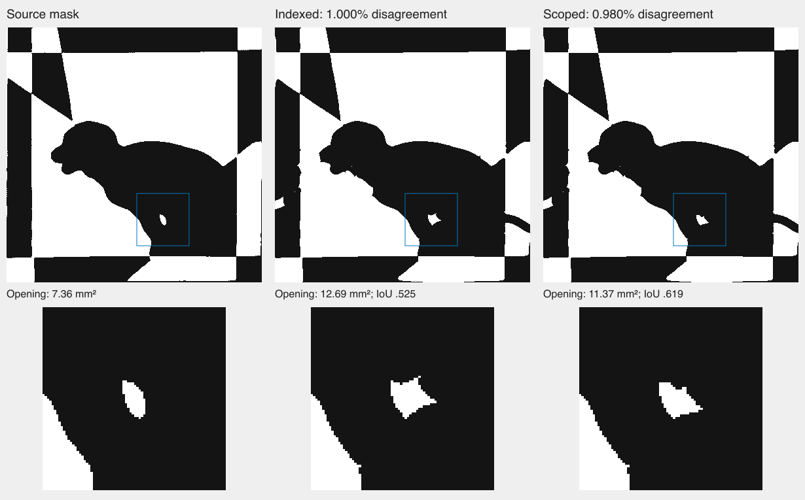

# Keep small-feature refinement local to an accepted design

The puppy's detail pass repeatedly violated clearance roughly 36 mm away from
the opening it was refining. It also moved distant image boundaries. Those
repairs consumed work, and the detailed candidate was discarded for increasing
whole-image error. See the [captured diagnosis](indexed-boundary-loss.md).

The common fitter now fixes distant controls while detailing an already
accepted independent candidate. It reuses the same region and control scoping
as existing feature polishing. Unaccepted candidates retain full freedom to
repair their geometry; explicitly symmetric and identical pairs keep their
existing constrained treatment. The temporary locks are removed before later
repair or editing. Shared controls, image targets, physical checks, iteration
limits and final acceptance thresholds are unchanged.

## Controlled experiment

All three variants start with the same saved candidate and use 160 steps.
The scoped variants change which controls can move; one also checks every
four steps instead of every forty. The experiment does not initialize any
fresh benchmark from saved cuts.

| Variant | Whole-mask error | Small-opening overlap | Geometry and paper |
| --- | ---: | ---: | --- |
| Incoming candidate | 1.0000% | 52.50% | Pass |
| Ordinary detail | 1.1039% | 61.58% | Pass |
| Scoped detail, same checkpoint interval | 0.9796% | 62.64% | Pass |
| Scoped detail, frequent checkpoints | 0.9849% | 60.44% | Pass |

The ordinary variant improves the opening but loses accuracy elsewhere. The
scoped variant improves both. Frequent checkpoints add work without improving
this result, so the implementation keeps the existing forty-step interval.

## Fresh photograph replay

A fresh solve from the half-resolution photo, without saved templates, applies
the detail pass and completes all 160 steps. Independent exported rendering
measures **0.9803%** error at 390 pixels and **1.1144%** at 780. Opening overlap
is **61.93%** and **60.58%**, respectively. Final geometry and paper checks pass.



The opening remains too angular and too large: 11.37 mm² versus the source's
7.36 mm². This change does not establish exact recovery or physical assembly.
Seventeen broader feature/routing tests, type checks, lint, the build and
874 application tests pass (one existing skip). All 1,044 pinned source files
match after those checks. The complete inverse suite is still running and
has exposed five failures so far. One captured curved-pattern repair passed
its logged checks but was discarded just after its deadline; see the
[deadline diagnosis](repair-completion-deadline.md). The earlier
supported-count metadata failure remains unresolved; a passing focused replay
does not explain it. The preview has not been refreshed.

## Regression checks

The fixed-candidate regression checks unchanged distant coordinates, improved
whole-image error and opening overlap at both resolutions, unchanged source
pixels, and independent final geometry/paper checks. Existing coverage and
shared-control regressions also pass: 12 focused tests in total. The unchanged
fresh half-resolution photo test passes separately.

```sh
nice -n 15 node --test --test-concurrency=1 \
  scripts/inverse/feature-details-local.test.mjs \
  scripts/inverse/feature-details.test.mjs \
  scripts/inverse/coverage-recovery.test.mjs
```

[Measurements and evidence hashes](scoped-feature-detail.json).
